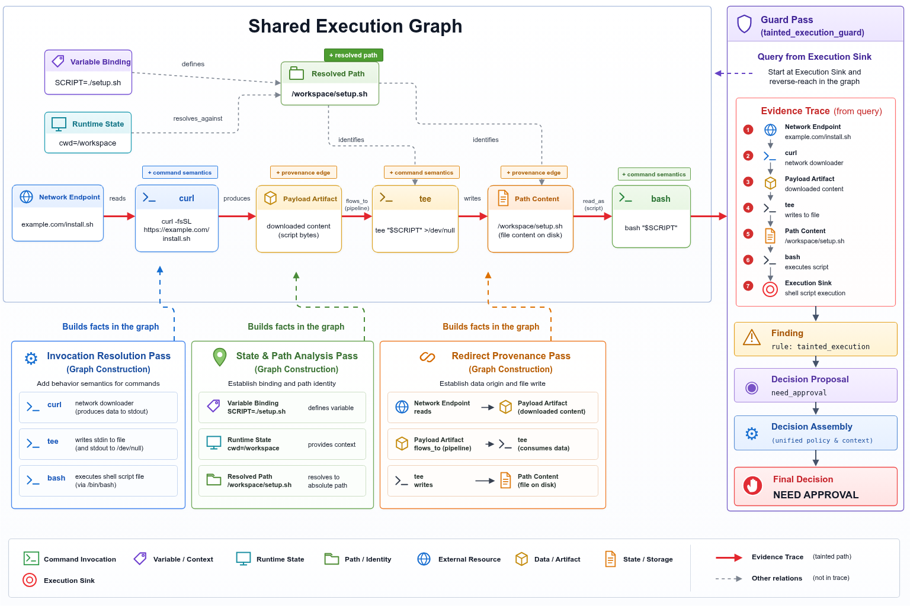

# Security Model: Risk Analysis, Decisions, and the Execution Boundary

Caushell uses multiple analysis modules to query the session execution graph and produce Evidence Traces, Findings, and Decision Proposals. Decision Assembly combines these results into the final decision for the current shell action.

## Shared Execution Graph and Analysis Modules



The action in the diagram is the same as the one in the [semantic model](semantic-model.md):

```bash
SCRIPT=./setup.sh
curl -fsSL https://example.com/install.sh \
  | tee "$SCRIPT" >/dev/null \
  && bash "$SCRIPT"
```

Before risk checks begin, Caushell adds the semantic relationships for the current action in three steps:

- **Invocation Resolution Pass** resolves the `curl`, `tee`, and `bash` invocations and adds their execution semantics.
- **State & Path Analysis Pass** uses the variable binding and current directory to resolve `./setup.sh` to `/workspace/setup.sh`.
- **Redirect Provenance Pass** establishes provenance links among the network content, pipeline, and file write.

The risk analysis modules then query this shared graph, each checking its assigned risk type.

## Tracing Evidence from an Execution Target

The risk analysis module shown in the diagram queries backward from the Execution Sink associated with `bash` and obtains the following evidence chain:

`Network Endpoint → curl → Payload Artifact → tee → Path Content → bash → Execution Sink`

This evidence chain connects the network source, downloaded content, file write, and script execution. The corresponding module records a `tainted_execution` finding and proposes `NeedApproval`.

An analysis can produce three types of related results:

| Result | Contents |
| --- | --- |
| Evidence Trace | The nodes and edges traversed by the risk relationship |
| Finding | Rule ID, description, and decision constraint |
| Decision Proposal | The decision proposed by an analysis module for a finding |

Each Finding has an `enforcement_class` field with a value of either `Normal` or `HardDenyFloor`. `HardDenyFloor` locks the final decision at `Deny`.

The `outside_workspace_mutation` rule requires approval for file writes, deletions, moves, and metadata changes whose resolved targets are outside the workspace. It also covers shell output redirections. When a mutation target or its effective working directory cannot be resolved, the rule requires approval rather than assuming the target is inside. Read-only paths do not trigger this rule. There is currently no allowlist or session-created-file exemption.

The `code_load_path` rule checks explicitly modeled in-process code-file inputs,
such as dynamic libraries. Paths inside the workspace, `/tmp`, or `/private/tmp`
are exempt; other paths and unresolved path bounds require approval by default.
Named modules and tool-owned code loading retain their existing module/resolve
policy. Additional trusted roots must grant the `in_process_code_load` scope;
read or write trust alone does not authorize loading code. This path exemption
does not override findings from tainted-code provenance.

Shell script references supplied by process substitutions or descriptor aliases
also enter nested-payload analysis. Only complete byte evidence is parsed as
shell code; unknown or partially recovered streams produce an
`external_stream_payload` approval gap. This does not make ordinary local script
references require approval. Descriptor aliases resolved to concrete filesystem
paths retain the existing file-source policy. Payload resolution is scoped to its owning
execution unit, and descriptor copies retain their selected stream even if the
original descriptor is subsequently redirected.

## Non-Shell Script Execution

Declared non-Shell payload execution and interpreter module dispatch require
approval under `non_shell_script_execution`. This applies to inline programs,
script files, stdin and nested calls, including local files. Interpreter
information modes and literal data are not script execution.

The rule contributes at least `NeedApproval`; `Observe` does not lower this
floor, and `Deny` can strengthen it. Other analysis continues across the action,
so an existing denial is not replaced by script approval. Python bodies are not
evaluated to derive child commands, stdout or completeness proofs. Interpreter
Profiles still describe source inputs, dispatch and declared CLI effects.

## Managed Resource Authorization

State operations may select declared endpoints on the same execution unit.
`resource: {kind: endpoint, usage: upload_target}` selects one endpoint role;
`resource: {kind: request_endpoints}` selects logical fetch/upload targets.
Targets remain network resources, not filesystem paths. Missing or incomplete
bindings retain approval.
Derived calls retain the owning namespace only through proved local execution
edges. Native dispatch effects opt in with `resource_namespace: same_executor`;
remote execution and undeclared namespace transfers retain approval.

The embedding host installs a `ResourceAuthority` through
`ShellQueryCore::set_resource_authority` or `CliRuntime::set_resource_authority`.
`ManagedResourceRegistry::register` records a resource instance, execution owner,
network namespace and exact endpoints. `grant` separately issues permission for
an operation on that instance. Registration and loopback location grant no rights.
Locator scopes support exact numeric HTTP(S) endpoints and an explicit
`HttpOrigin` contract for an entire owned service. Origin registration names
only the root locator; it is not inferred from a pending URL. Neither scope
resolves hostnames, matches path prefixes or guesses encoded-path semantics.

Before checking, the host calls `admit_check` for the exact execution-frame
binding. Neither a Profile nor a tool-facing stdio/socket request can register a
resource, grant permission or admit a frame. All selected targets must match a
live instance and an operation grant. Resource references are authority-local;
instance replacement cannot inherit a previous instance's permission.

`serve-host-stdio` connects an owning executor over private inherited pipes.
The host first creates its service, registers its instance and namespace, then
separately grants operations under its policy. These messages are not available
on `serve-stdio` or `serve-unix`. The host control descriptors must never be
passed to a model or tool subprocess; the embedding host is the trusted principal.
The host must isolate its control process from tools, including process-inspection
interfaces. A matching user ID or network address is not host authentication.

Each proposed execution holds the resource snapshot until the host reports
completion. `BeginExecution` requires the exact current checked binding and an
Allow decision or matching single-call approval. Deny cannot be authorized.
Resource changes are rejected while an execution is pending. The host executes
the exact checked action after the begin acknowledgement, waits for it to finish,
then sends `CompleteExecution`. Judge-only checks never start execution.
EOF or protocol failure ends the authority; the host must stop its owned work
and must not resume or recreate authorization from persisted check records.

Registration, grant and admission handles revoke their records on drop and have
bounded lifetimes. Checks acquire fresh authority snapshots; lifecycle changes
during analysis invalidate positive proofs. A host executing an allowed request
uses `with_current_snapshot` with the same binding and holds the lifecycle guard
through execution and completion. Resource retirement must precede removal or
replacement of the managed route. Persisted check evidence does not restore
live authority after restart.

`resource_unless_modifiers` and `resource_environment_absent` declare route
prerequisites. Curl requires current proxy-environment observations; redirects,
request-target/header overrides and alternate transports do not gain permission
from the original endpoint. These declarations describe scope, not authorization.

Resource authorization removes only the covered state-operation approval.
Explicit policy denials, other guards and the non-Shell script approval floor
remain independent. Single-call approval does not create a resource grant.
Permissions cover an operation class at the registered endpoints; a `mutate`
grant is not a POST-only contract. Policies requiring narrower method or body
constraints retain approval until those constraints have a declared contract.

## Decision Assembly

After all analysis modules complete, Decision Assembly produces one final decision according to the following priority:

| Condition | Final decision |
| --- | --- |
| A Finding has `enforcement_class = HardDenyFloor`, or any decision proposal is `Deny` | `Deny` |
| Otherwise, any decision proposal is `NeedApproval` | `NeedApproval` |
| Otherwise | `Allow` |

## Harness Execution Boundary

Caushell returns the final decision before the process starts. The Harness integration then handles the result through its hook or tool protocol:

| Decision | Integration behavior |
| --- | --- |
| `Allow` | Continue executing the shell action |
| `NeedApproval` | Handle through the Harness's confirmation capability or the integration configuration |
| `Deny` | Block before the process starts |

The Harness integration provides the confirmation interface and interaction flow. The exact mapping depends on the hook or tool protocol of the corresponding Harness.

## Fallback When Analysis Is Unavailable

If Caushell cannot complete its analysis, `failure_action` determines the integration's fallback behavior:

| `failure_action` | Fallback behavior |
| --- | --- |
| `allow` | Allow execution |
| `need_approval` | Require confirmation |
| `deny` | Block execution |

When analysis does not produce a final decision, the integration falls back according to `failure_action`. When a decision is available, the integration applies the result from Decision Assembly. See [Configuration](configuration.md) for setup details.

## Relationship to Sandboxing

Caushell and a sandbox can be deployed together. Caushell analyzes the semantic relationships in a shell action before the process starts; the sandbox restricts system calls, file access, network access, and other resources at runtime.

## Further Reading

- [How Caushell works](how-it-works.md)
- [Semantic model: AST, command modeling, and the session execution graph](semantic-model.md)
- [Configuration](configuration.md)
