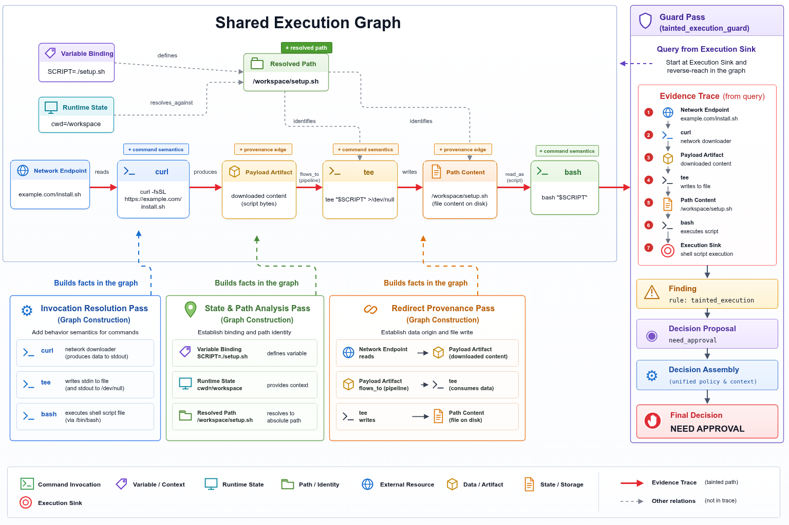

# 安全模型：风险分析、决策与执行边界

Caushell 通过多个分析模块查询会话执行图，生成证据链、风险项（Finding）和决策建议。Decision Assembly 汇总这些结果，为当前 shell action 生成最终决策。

## 共享执行图与分析模块



图中的 action 与[语义模型](semantic-model.zh-CN.md)相同：

```bash
SCRIPT=./setup.sh
curl -fsSL https://example.com/install.sh \
  | tee "$SCRIPT" >/dev/null \
  && bash "$SCRIPT"
```

风险检查开始前，Caushell 通过三个步骤补充当前 action 的语义关系：

- **Invocation Resolution Pass** 解析 `curl`、`tee` 和 `bash` 的命令调用，并补充相应的执行语义。
- **State & Path Analysis Pass** 根据变量绑定和当前目录，将 `./setup.sh` 解析为 `/workspace/setup.sh`。
- **Redirect Provenance Pass** 连接网络内容、管道和文件写入之间的来源关系。

随后，各风险检查模块查询这张共享图，识别各自负责的风险类型。

## 从执行目标追溯证据

图中的风险检查模块从 `bash` 对应的执行目标（Execution Sink）开始反向查询，得到下面的证据链：

`Network Endpoint → curl → Payload Artifact → tee → Path Content → bash → Execution Sink`

这条证据链将网络来源、下载内容、文件写入和脚本执行连接在一起。对应的检查模块记录 `tainted_execution` 风险，并提出 `NeedApproval`。

一次分析可以产生三类相互关联的结果：

| 结果 | 内容 |
| --- | --- |
| Evidence Trace | 风险关系经过的节点和边 |
| Finding | 规则 ID、说明和决策约束 |
| Decision Proposal | 某个分析模块针对风险项提出的决策建议 |

每个 Finding 都带有 `enforcement_class` 字段，取值为 `Normal` 或 `HardDenyFloor`。`HardDenyFloor` 会把最终决策固定为 `Deny`。

`outside_workspace_mutation` 规则对工作区外的文件写入、删除、移动和元数据修改要求审批，也覆盖 shell 输出重定向。无法解析修改目标或其生效工作目录时，同样要求审批，而不假定目标位于工作区内。只读路径不触发该规则。目前没有特殊名单或“本会话创建文件”的豁免。

`code_load_path` 规则检查已明确建模的进程内代码文件输入，例如动态库。工作区、
`/tmp` 和 `/private/tmp` 内的路径豁免；其他位置及无法确定的路径范围默认要求审批。
按名称加载的模块及工具内部加载仍沿用现有模块／解析策略，不猜测其安装位置。
额外信任目录必须具有 `in_process_code_load` 权限，仅有读取或写入权限不足以授权代码加载。
路径豁免不覆盖污点代码来源产生的审批。

通过进程替换或文件描述符别名提供的 Shell 脚本，同样进入嵌套载荷分析。
只有完整的内容证据才交给 Shell 解析；未知或仅恢复部分内容的流产生
`external_stream_payload` 审批缺口，不因此要求普通本地脚本一律审批。
已解析到具体文件路径的描述符别名，仍沿用现有文件来源策略。
载荷解析结果只属于其对应的执行单元；复制的描述符保留原先选定的流，
不随原描述符的后续重定向而改变。

## Decision Assembly

所有分析模块完成后，Decision Assembly 按下面的优先级生成唯一的最终决策：

| 条件 | 最终决策 |
| --- | --- |
| 存在 `enforcement_class = HardDenyFloor` 的 Finding，或任意决策建议为 `Deny` | `Deny` |
| 否则，任意决策建议为 `NeedApproval` | `NeedApproval` |
| 其余情况 | `Allow` |

## Harness 执行边界

Caushell 在进程启动前返回最终决策，Harness 集成再按照 hook 或工具协议处理该结果：

| 决策 | 集成行为 |
| --- | --- |
| `Allow` | 继续执行 shell action |
| `NeedApproval` | 映射为请求确认、阻断或仅记录 |
| `Deny` | 在进程启动前阻断 |

`NeedApproval` 在 Claude Code 中返回 `ask`；在 Codex 中默认阻断，`observe` 模式仅记录并继续；在 DeepSeek Harness 中返回 `ask`，没有审批通道时拒绝执行。完整映射见[Harness 集成与执行行为](integrations.zh-CN.md)。

## 分析不可用时的回退

如果 Caushell 未能完成分析，`failure_action` 决定集成的回退行为：

| `failure_action` | 回退行为 |
| --- | --- |
| `allow` | 放行 |
| `need_approval` | 要求确认 |
| `deny` | 阻断 |

分析未能产生最终决策时，集成按照 `failure_action` 回退；得到决策后则执行 Decision Assembly 的结果。配置方式见[配置说明](configuration.zh-CN.md)。

## 与沙箱的关系

Caushell 在进程启动前分析 shell action 的语义关系；沙箱在进程运行时限制系统调用、文件访问、网络和其他资源。

## 进一步阅读

- [工作原理总览](how-it-works.zh-CN.md)
- [语义模型：AST、命令建模与会话执行图](semantic-model.zh-CN.md)
- [执行前分析与运行时沙箱](pre-execution-and-sandbox.zh-CN.md)
- [Harness 集成与执行行为](integrations.zh-CN.md)
- [配置说明](configuration.zh-CN.md)
