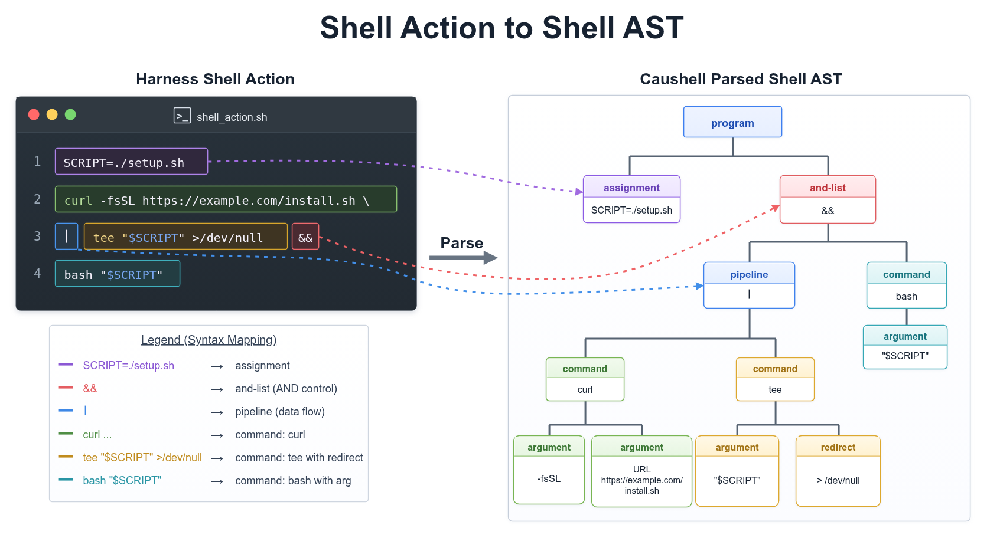
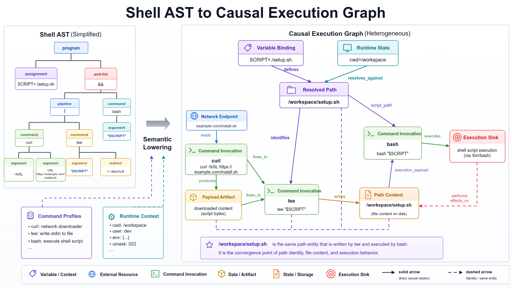

# Semantic Model: AST, Command Modeling, and the Session Execution Graph

Caushell adds the commands and semantic relationships from a shell action to a queryable session execution graph. This process consists of syntax parsing, command modeling, and session graph extension, which establish syntax structure, command behavior, and session relationships in sequence.

## Shell AST



The action in the diagram is:

```bash
SCRIPT=./setup.sh
curl -fsSL https://example.com/install.sh \
  | tee "$SCRIPT" >/dev/null \
  && bash "$SCRIPT"
```

The parser converts the raw text into a Shell AST and preserves the syntax structures needed by later modeling:

| Shell construct | AST structure | Later use |
| --- | --- | --- |
| `SCRIPT=./setup.sh` | assignment | Establish a variable binding |
| `curl ... \| tee ...` | pipeline | Represent the connection from standard output to standard input |
| `&&` | and-list | Indicate that the later command depends on the earlier command succeeding |
| `curl`, `tee`, `bash` | command | Locate command invocations that require modeling |
| `"$SCRIPT"` | variable reference | Resolve the variable reference |
| `>/dev/null` | redirect | Record the redirection and its target |

The Shell AST is the output of the syntax stage. Command behavior, resolved paths, and provenance are established in later stages.

For a complete Bash double-quoted string, token text is the exact source between the outer quotes. Newlines, whitespace, escapes and expansion spelling are retained, together with the original source span and independently collected substitution facts. The parser does not evaluate this text or reconstruct it by concatenating AST children. Existing argv decoding and value materialization establish the operand value; incomplete quotes remain a partial parse.

Before parsing a recursive inline payload, its outer-shell operands must become complete argv values. Recursive materialization reuses the quote-aware lexical decoder for literals and the existing exact-scalar resolution for bindings. Decoded literals, resolved scalars and runtime argv data are not expanded again; original quote metadata and spans remain available. Static prefixes, unsupported expansions and incomplete values remain unresolved and use the existing approval fallback. Canonical inline-shell expansion and nested payload records share this materialization path. Already-complete program text from stdin, files or configuration is not subjected to another outer-quote decode.

## Command Modeling

### Shared path scope and purpose-scoped exemptions

`PathScopeQuery` proves containment from existing path facts: a concrete path,
a filename-family directory, or every root of a nonempty bounded set. Relative,
unknown, empty or escaping bounds are unproven. Paths are normalized lexically;
the query does not inspect the filesystem or resolve symlinks.

`RunnerContext` compiles `PathExemptionPolicy` once per request. It combines the
workspace, temporary roots and existing configuration, but each grant applies to
an operation and, for configured trust, its selected rule and trust scope. Write
permission does not grant execution, execution does not grant startup-config
loading, and no path exemption bypasses the deletion guard. Risk passes retain
their own decisions: an exempt path is not a global Allow.

File execution uses the owning execution unit, its `execute_payload` effect and
its `script_source` path facts, including derived/wrapped calls. Every target
must be proven in an execution-granted scope. Workspace and temporary file
references are exempt independently of interpreter language; outside or unknown
file targets require approval by default. Unsupported inline programs, stdin
and descriptor-backed inputs retain their existing execution checks. Resolve
policy runs in the session-analysis phase so this decision uses staged facts,
not raw argument spelling. Historical nested-shell payload references are joined
to canonical nodes by their resolved parent and parsed source positions.

### Make evaluation and argv ownership

The Make Profile owns permuted options and their operands before selecting a
build form. `-E`/`--eval` introduces opaque Make code, not Bash, and uses the
existing nested-payload approval path. Repetitions retain all fragments;
`-n`, `-q`, `-p` and `-t` do not waive evaluation. Unknown options and missing
operands remain unresolved. Literal option operands and words after `--` are
not reinterpreted as Make options.

Function-bearing command-line assignments and `!=` shell assignments are also
explicit code carriers. Immediate assignments can expand while argv is parsed,
even with help/version; the Profile retains them separately from `--eval`,
which help/version skip. This distinction was checked with container-local
warning-only probes, not filesystem or shell-execution payloads.

Ordinary builds, literal assignments and workspace/temporary explicit Makefiles
retain the existing project policy. Explicit Makefiles use existing code-load
path checks; `-f -` is stdin Make code rather than a filename. `-C` builds remain
unresolved because repeated directory changes are sequential and relative
Makefiles must not be attached to the caller's cwd. This is declared in the
Profile; no new Pass, base-binder exception or Make interpreter is introduced.

Sources: [GNU Make options](https://www.gnu.org/software/make/manual/html_node/Options-Summary.html),
[GNU Make variable assignment](https://www.gnu.org/software/make/manual/html_node/Setting.html).

### Native rename argv and filename transforms

The `rename_arguments`, `rename_util_linux_arguments` and
`rename_perl_arguments` payload-projection formats consume a plain-value
`remaining_args` vector, not a newline-joined program. Their declarations require
move-source, destination-write and opaque-execution slots. The existing path
and execution guards consume those facts; no rename-specific risk pass is used.

The ambiguous `rename` profile joins util-linux and Perl interpretations whose
native grammars can apply, including their different option ordering. Argument
count alone does not select an implementation. `rename.ul` explicitly declares
util-linux; `file-rename` and `prename` declare Perl. In particular, an arbitrary
Perl expression remains opaque even with `-n` or enough arguments for util-linux.

Complete supported `s`, `y` and `tr` programs project source and destination
paths. Expression evaluation flags, interpolation, embedded code and unsupported
regex/replacement syntax retain opaque execution. No Perl interpreter is called.
Unknown input filenames retain their original path bounds; transformed bounds
require a separate component-local proof and retain intermediate root branches.
Unproven destinations stay unknown instead of inheriting source containment.

Perl-style filename lists from complete stdin evidence use line or NUL records,
never shell parsing. Unknown or partial input retains unknown paths. Native
byte/operation budgets, capped aggregate transformation work and output bounds
prevent expansion of large replacement results. Only profiles declaring these
formats enter the decoder; other tools keep their existing behavior.

Unknown rename targets retain the argv/program/file evidence that produced
them, with `preserves_source: false`: failure to transform a bounded input is
not an identity transform and is not a synthetic stdin read. Only an actual
Perl filename-list fallback uses stdin evidence. util-linux basename-only
replacements can project existing path-set bounds when slash and dot-component
safety are proven; original and rewritten inclusive roots are both retained.
Dialect ambiguity, whole-path rewrites and unproven suffix removals remain
unresolved. Filename selection predicates are not inferred from path roots.

### External state operations and native operand grammars

A Profile may declare a non-filesystem effect explicitly:

```yaml
- kind: state_operation
  state_operation: {domain: system_clock, operation: mutate}
  target: {kind: none}
```

Domains are `system_clock`, `filesystem_mount`, `service_manager`,
`cloud_resource`, `remote_access`, `shell_history`, `network_configuration` and
`host_identity`, `connection_verification`, `display_configuration` and
`container_runtime`; operations are `inspect`, `mutate`,
`control` and `opaque`. The typed declarations are retained in execution
semantics and exposed by the public execution-semantics Query. They do not
invent local files, remote resource ownership, successful execution or live
system observations. The state guard defaults to approval for mutation,
control and opaque operations; inspection does not trigger that guard.
The `state_safety` family and its individual rules use existing policy
overrides and decision precedence. Filesystem and other guards remain
independent. Commands without a state-operation candidate return before
the state guard queries the Graph; candidate queries cover the current action,
not a scan of all session history.

`connection_verification` describes explicit connection peer-verification
overrides, not persistent host configuration. Disabling verification is a
`control` operation, handled by the existing state guard. curl declares direct,
HTTPS-proxy and DoH verification overrides independently; wget also recognizes
inline certificate-check settings, including its verification-bypassing `quiet`
mode. An override value that does not prove verification enabled retains the
control effect.

Modifiers may opt into conditional effect emission without changing option
ownership, bound operands, or the presence of the modifier itself:

```yaml
matcher: {kind: any_flag, flags: [-k, --insecure, --no-insecure]}
effects_when:
  unless_modifiers: [information]
  last_option_not_matching: {kind: literal, value: --no-insecure}
```

`unless_modifiers` names modifiers in the same scope; optional `unless_forms`
names informational forms whose selected operation does not use those effects
(for example, listing curl engines). `last_option_not_matching`
requires scoped `any_flag` ownership and compares the last owned occurrence of
that modifier, not an argv substring. The compared word is the decoded flag
name (also in short clusters), with any long inline `=value` preserved. Regexes
are compiled at Profile load and must match the whole word. Only a proven match
suppresses the effects; missing ownership evidence retains them. Option
operands and data after `--` cannot restore a setting. Omission preserves the
existing unconditional modifier behavior. Informational forms may suppress the
effects by declaring their informational modifier in `unless_modifiers`.

Interface configuration and ARP entry updates declare `network_configuration`
mutations; setting a hostname, loading a name file or requesting a boot fallback
declares `host_identity` mutation. These declarations reuse the same state guard,
not a filesystem metadata effect without a target. Queries have no mutation
candidate. Native argv ownership distinguishes global display options from
interface configuration tails, and ARP's `-f` mode from its positional entry file.

`date` declares clock mutation for explicit `--set` and positional time-setting
forms. A `+FORMAT` operand, GNU `--date` and BSD `-j` conversion are not clock
mutations. GNU date-file reads and reference-file metadata keep separate input
facts; BSD input formats do not become fictitious file paths. These Profiles do
not add a platform probe or read configuration/input files during analysis.

The `history` Profile declares a `shell_history` mutation for clearing the
history list or deleting selected entries. It respects clear-before-file and
store/expand-before-delete ordering; file reads and writes retain separate
path effects. Display, expansion and ordinary record insertion do not gain a
removal effect. No history-list entry is represented as a filesystem path.

Native argv grammars are opt-in Profile declarations, not command-name cases
in shared code:

`cp` uses `permuted_options` with complete option ownership before `--`.
Unknown words that can become options keep the invocation unresolved; a proven
non-option path prefix or an explicit terminator retains data-only operands.
Long-option values are bound separately from their names, including optional
backup/preserve/reflink/update/context controls and required sparse/no-preserve
operands. Backup modes retain the distinction between content opens and
namespace replacement. The existing resolution guard handles uncertainty;
there is no separate copy-command risk pass.

- `option_operand_matcher` recognizes a complete option-shaped positional
  operand in a flat scoped grammar, such as a symbolic mode beginning with
  `-`. Unknown controls remain unresolved.
- `leading_options_with_operand` permits options before and after one
  positional operand. The next positional starts an untouched command/data
  tail; `--` always ends option ownership. Dynamic argv width remains unknown.

- `optional_short_octal_prefix` consumes only attached octal digits, resumes
  decoding the rest of the short cluster and never takes the next argv word.
- `word_attached` and `optional_word_attached` use scoped `exact_names`
  matching. Exact declared words take precedence; otherwise the longest
  explicitly attached-word declaration owns its suffix. They never consume
  a following word or enable short-cluster guessing.
- `word_attached_or_next_arg` uses the same scoped `exact_names` ownership,
  but a bare declared option requires and owns the immediate next argv item.
  Thus `-c8` and `-c 8` both bind `8`. Exact declared option names win over
  prefix matches, and attached matches use the longest declared name. It does
  not enable short clusters or alter the older operand modes.
- A structured `regex_capture` matcher selects a capture only when the whole
  operand matches. Regexes are compiled once at Profile loading and shared
  across clones. Captured bytes are semantic projections; original execution
  argv, source spans and materialization provenance are preserved. Dynamic,
  empty and absent captures remain unknown. A target may declare
  `unresolved: true` when its native form is recognized but its value is not
  representable by the supported grammar; it cannot also select preferred
  source slots.
- The `basename` derived-path rule relocates a complete lexical final
  component under execution cwd. Empty, dot/dot-dot and incomplete operands
  do not produce a guessed destination.

Risk lineage starts from the actual execution or upload entrance, not every
read made by the same process. Code sinks use the Profile's payload slots and
implicit code sources; ordinary stdin for a fixed inline program is not code.
An upload `network_endpoint` effect may declare `input_scope: {slots: [...],
stdin: true}`. Its destination slot always participates; stdin participates
only when a bound `consume_stdin` effect consumes it. Unspecified contracts,
untyped inputs and all upstream producer lineage remain conservative. Original
Graph read facts are retained, including authentication keys; an explicit later
upload of a key still traces to that path. Undeclared scope slots are rejected.

The `network_upload` rule uses declared `upload_target` endpoints independently
of sensitive-source tracing. The reusable endpoint query works on current
execution-unit adjacency, including derived calls, and statically exempts
loopback destinations. An ordinary fetch or dry-run keeps its own declaration.
Explicit request-byte scopes share the content dependency query with sensitive
data tracing. A fetch that sends file-derived bytes is still outbound local
data; literal query fields and unrelated authentication reads are not inferred
to carry that file's contents. Curl `-G --data` declares a query endpoint and
retains its actual file/stdin request inputs and downloaded response lineage.
Profiles may declare possible connection overrides as endpoint usage
`transport_target`. The shared endpoint query checks these separately from
logical upload/download targets; nonlocal or unresolved routes prevent a
loopback transmission exemption. Their input scopes describe only declared
address/authentication bytes, not an invented response or complete request.
Bounded and unresolved read operands also produce `PathSelectionContent`
artifacts. These preserve the read's content dependency and path resolution
and, when available, its lexical selector (for example a HOME-relative glob),
without inventing glob expansions, concrete filenames or file existence;
concrete-only path queries do not treat them as exact `PathContent`.

Structured projection targets not selected by a known branch retain explicit
inapplicable slots, rather than disappearing as unbound effects. A complete
empty scalar can match an explicitly declared no-effect regex branch. Missing
operands, dynamic values and undeclared empty values remain unknown; this does
not make empty path or executable targets valid.

Presence of a pipeline producer cannot certify unparsed executable stdin.
Known explicit file stdin keeps its original data edge and an additional
`script_source` consumption when the Profile declares stdin code. The existing
script-source rule (default Observe, configurable NeedApproval) evaluates that
source. Unknown filenames/descriptors keep unresolved-input approval. This
does not probe file contents or add a new risk pass.

Ordinary package locators also distinguish RPM from other package managers;
an RPM local file is not a Yum registry reference.



Command modeling uses the AST and runtime context to add queryable behavioral semantics to each command invocation:

| Input | Information provided |
| --- | --- |
| Shell AST | Commands, arguments, pipelines, redirections, and control connections |
| Command Profiles | Command forms, argument roles, inputs and outputs, execution effects, and subcommand dispatch |
| Runtime shell state | cwd, variables, aliases, functions, positional parameters, and their visibility |
| Committed session facts | State and provenance already established in the same session |

Command Profiles describe the supported invocation forms and behavior of different commands. Caushell matches the current invocation to a Profile, determines whether each argument represents a path, network address, or content to be executed, and identifies how the command reads, writes, or executes that content.

For the action in the diagram:

| Command | Modeling result |
| --- | --- |
| `curl` | Read content from a network address and write it to standard output |
| `tee` | Read content from standard input and write it to a target path |
| `bash` | Execute the target path as a shell script |

`SCRIPT=./setup.sh` establishes a variable binding. After resolving the variable references, the two command invocations can be represented as:

```bash
tee ./setup.sh
bash ./setup.sh
```

The target written by `tee` and the script executed by `bash` therefore both refer to `./setup.sh`. This relative path is resolved further against the current directory during session graph extension.

### Parameter value projections

A path parameter can declare `value_projection` when its operand contains more than the path itself. The binding still retains the complete argument, source span, binding origin and materialization provenance. Path analysis uses a separate semantic view; command dispatch and execution arguments are not rewritten.

```yaml
- name: test_paths
  semantic: {kind: path, role: read, purpose: generic_operand}
  binding: {kind: remaining_positionals}
  cardinality: optional_many
  value_projection:
    kind: prefix_before
    delimiter: "::"
    if_absent: original

- name: cache_path
  semantic: {kind: path, role: write, purpose: generic_operand}
  binding: {kind: following_flag, flag: "--override", operand_mode: next_arg}
  cardinality: optional_many
  value_projection:
    kind: key_value
    separator: "="
    key: cache_dir
```

`prefix_before` selects text before the first delimiter: `tests/test_api.py::test_login` contributes `tests/test_api.py` to path analysis. Without a delimiter, `if_absent: original` (the default) retains the operand; `if_absent: unknown` leaves it unresolved. `key_value` matches the complete key before the first separator: `cache_dir=/etc/pytest-cache` contributes `/etc/pytest-cache`, whereas `console_output_style=classic` contributes no cache path. Additional separators in the value are retained.

Unknown and inapplicable are distinct. Empty projected paths, malformed keyed operands, unresolved values and implicit runtime operands remain unknown. A known nonmatching key produces no path and no mutation fallback. An unresolved unquoted expansion can introduce additional argv fields, so a static prefix does not establish applicability or a complete path. For a fully double-quoted argument, a completed static delimiter can establish a path prefix or a nonmatching key even if the suffix is unknown. Exact materialized values and decoded literal data are not expanded a second time. Runtime bounds on a whole operand are not reused as bounds on its substring.

Path facts, path-content provenance, mutation targets, derived paths and catastrophic target classification consume the same semantic view. An unknown projected root remains unknown rather than erasing a derived effect. Existing guards decide approval or denial; projection adds no risk pass or command-name special case. Each bound operand is projected independently, without imposing a command-specific repeated-option precedence rule.

The declaration currently supports filesystem `path` semantics except `cwd_anchor`, not command references or payloads. Omitting it preserves the existing identity view without allocating projected values. Projection alone does not activate a Profile or discover configuration. The built-in pytest Profile combines projections with the configured-path declaration below.

### Structured operands and encoded argv

`structured_projection` declares a tool-owned grammar on a plain-value or `script_file_ref` payload parameter: an optional separator, ordered literal/prefix/keyword-value branches, and a fallback. Prefix matching consumes the prefix; a branch without a target proves that no associated effect applies. A script reference can retain its executable boundary while emitting a separate declared path view, without binding the same argv twice. Targets emit distinct virtual slots with declared semantics without rewriting argv. Source spans and materialization provenance are retained. Ordered `sources` select the first present original slot, never replacing an explicit unknown with a later default. Separators, references and name collisions are validated at load time.

```yaml
structured_projection:
  separator: ','
  branches:
    - matcher: {kind: literal, value: '-'}
    - matcher: {kind: prefix, value: '@'}
      target:
        name: child_commands
        semantic: {kind: command_ref, dispatch: wrapper_command}
  fallback:
    name: output_bases
    semantic: {kind: plain_value}
```

`command_whitespace_argv: child_commands` dispatches each semantic value as executable/argv split on whitespace, not Bash source. Executables and arguments retain their argv-data status: dollar signs, quotes, pipes and semicolons are not interpreted again. Unresolved entries remain child-call gaps, and unknown writes remain mutation candidates. Existing scalar `value_projection` is unchanged. Only declared operands are structurally decoded.

Ordinary dispatch also consumes `BoundParameter.semantic_values()` for its executable, argv, environment assignments and unsets. Original operands, spans and binding sources remain intact. Known projected values are argv data, not new shell source. Unknown projected commands remain unresolved; unknown projected argv retains a child candidate and an explicit analysis gap without borrowing bounds from its source operand. An unknown environment overlay invalidates inherited and partially known child values, including after a declared environment clear; it never changes the parent bindings. Already-materialized complete argv words are reused when binding metadata is attached, rather than expanded a second time. Undeclared operands retain their previous materialization behavior.

`stdin_from_parent: true` declares delivery of generated tool data to child stdin. Existing dispatch, execution-context and stream-provenance machinery retain the opaque input, including wrapper dispatch; `@bash` therefore requires approval. Unresolved calls inside wrappers reach the existing approval fallback. No new risk pass, dynamic probing or Harness field is involved.

The first built-in user is `nsys stats/analyze --output`, distinguishing console output, file basenames, default basenames and `@command`. `sibling_files` produces a `BoundedPathSet` under the known output directory instead of inventing a concrete file named after the basename; only its directory is normalized before appending report filenames. Potential SQLite creation from `.nsys-rep` and explicit `--sqlite` targets remain separate effects. Help does not trigger them.

Ordinary `nsys profile` collection now declares the application/argv dispatch, child-only comma-separated environment overrides and application stdout provenance. Explicit output basenames and the default `report#` produce bounded sibling-file families under the effective cwd; they are not invented concrete report names. Duration/capture-shutdown forms declare possible `control_process` effects, while explicit `--kill=none` suppresses the modeled termination effect only. The graph-backed process-control guard defaults to approval and supports rule-policy `allow`/`deny` overrides. Approval does not depend on optional known-action metadata or a known PID; a declared effect with no action mapping remains a process-control fact with unknown target. The guard skips before querying the graph when no current control candidate exists, and its allow override cannot bypass independent mutation/deny rules.

Persistent `launch/start/stop/shutdown` sessions, callbacks/plugins, command files, identity/environment setup modes and native percent report templates remain opaque and require approval. Listed stats/analyze built-in reports/rules and formats are statically accepted; other code references, report/format arguments and custom directories require approval. List alignment and execution counts are not replayed exactly: all output candidates are retained, potentially increasing approvals. Report content and process state are not dynamically inspected; no process discovery or new Harness field is introduced.

Reference: [NVIDIA stats CLI](https://docs.nvidia.com/nsight-systems/UserGuide/index.html#cli-stats-command-switch-options), [profile CLI](https://docs.nvidia.com/nsight-systems/UserGuide/index.html#cli-profile-command-switch-options).

### Shell word-list iteration

Shell word-list `for` loops retain their variable, list words and body/shell
scope in the parse artifact. The ordered variable overlay gives body uses an
abstract member domain, reusing existing argv/path-set and path-template
contracts rather than enumerating files or selecting one iteration. Static
lists, complete positional lists and proven pure pathname-generation bounds
are supported, with at most 256 list members. Raw producer spellings such as
`./` are preserved until affix and path resolution. Only whole double-quoted
variable uses carry a one-field domain; splitting, unsupported substitutions,
unknown lists and oversized proofs retain unknown values. Scalar/runtime
writes invalidate domains. Loop exit invalidates the final scalar instead of
restoring an old value, and isolated loop scopes do not change caller state.
Bounds become ordinary Graph path facts, never guessed concrete filenames or
persisted exact variable values. No new risk Pass or Harness input is required.

### Opaque code and keyword-owned shell commands

`{kind: payload, language: opaque, source: inline_string, recursive: true}` explicitly declares executable code outside the modeled shell languages. The existing recursive-analysis record retains its source and unsupported-language evidence; the existing ResolvePolicy pass defaults the `opaque_non_shell` subtype to approval. Named Python, JavaScript and Perl payloads use the same unsupported-code boundary while retaining their language identity. This applies to inline programs, script references and stdin, even when the text is literal or locally produced. A known string is not a modeled program. Python/Node script Profiles also retain separate script-source read facts. Registered Python module CLI contracts and modeled shell payloads keep their own semantic analysis; SQL client contracts are unchanged. No language interpreter, guessed internal path, dynamic code read or new risk pass is introduced. Explicit subtype policy overrides remain available and cannot override independent deny findings.

For a mixed option carrying a shell command, use a virtual plain-value slot and the existing `command_string: {slot: proxy_command, syntax: posix_shell}` dispatch:

```yaml
structured_projection:
  first_match_only: true
  branches:
    - matcher:
        kind: keyword_value
        keyword: ProxyCommand
        case_insensitive: true
        allow_quoted_keyword: true
        disabled_values: [none]
        unresolved_markers: ['%']
      target: {name: proxy_command, semantic: {kind: plain_value}}
```

The keyword boundary is space/tab/CR/LF or `=`; only the leading separator run is consumed, not quotes or syntax in the command body. ASCII case folding applies to the keyword and disabled sentinels. Optional configuration-token quoting allows a double-quoted keyword segment terminating that token. `first_match_only` stops after the first matched, disabled or unknown operand; unrelated known keywords do not consume it. It defaults to false, preserving existing multi-value behavior. Declared unresolved markers and missing/dynamic values emit an unknown slot, so the existing unresolved-child policy requests approval rather than inventing a concrete command. Only operands with a declared grammar are visited. Proxy stdout is SSH transport, not implicitly parent stdout. OpenSSH source: [keyword parsing and ProxyCommand precedence](https://github.com/openssh/openssh-portable/blob/master/readconf.c), [configuration token quoting](https://github.com/openssh/openssh-portable/blob/master/misc.c).

### Structured patch data and modification targets

A form may opt into `payload_projections`. This decodes a complete tool-owned data protocol, not Bash or another executable language. An undeclared form is not scanned. The first format is `codex_apply_patch`; the Profile, not the generic binder, selects it:

```yaml
payload_projections:
  - format: codex_apply_patch
    source: {kind: slot, name: patch}
    reads: patch_reads
    writes: patch_writes
    deletes: patch_deletes
    moves: patch_moves
    max_bytes: 1048576
    max_operations: 4096
effects:
  - {kind: read_path, target: {kind: slot, name: patch_reads}}
  - {kind: write_path, target: {kind: slot, name: patch_writes}}
  - {kind: delete_path, target: {kind: slot, name: patch_deletes}}
  - {kind: move_path, target: {kind: slot, name: patch_moves}}
```

The source must be an unprojected plain-value parameter. Alternatively, `source: {kind: stdin}` requires a plain `stdin_data` declaration. Output slot names must be distinct, must not collide with existing slots, and must have matching effects in that form. Omitted budgets default to 1 MiB and 4096 operations; both must be positive. `no_arguments` distinguishes no arguments from flags and `--`, unlike `no_positional_args`.

The built-in `apply_patch`/`applypatch` Profile accepts exactly one patch argument, or effective stdin with no arguments. Add emits write; update emits read and write; delete emits deletion; update with move emits source read/move and destination write. Multiple operations retain all targets. Empty patches and proven absent effect classes have explicit empty semantic views, not unknown mutations. Existing path and catastrophic guards plus the location-independent deletion rule decide the action; no Harness request field is added.

The optional `moves` slot requires a matching `move_path` effect and a format
with native relocation semantics. It distinguishes a moved source from content
deletion. Older custom projections without that slot retain their conservative
source-removal-as-deletion view. Unknown patches retain unknown moves as well as
writes/deletions when those effects are declared. Ordinary moves remain subject
to source/destination path policies; they do not acquire a blanket exemption.

The decoder validates the whole envelope, operation headers and update chunks, without applying the patch or interpreting inserted/context lines as commands. It preserves literal path bytes, Unicode and spaces; filenames are not shell-expanded a second time. Materialization of the *outer* shell argument still precedes projection. Truncated, malformed, dynamic, over-budget or environment-tagged payloads retain unknown writes/deletions rather than proving a safe prefix. The pure decoder is linear and copies original source metadata once per effect class, not once per file.

Canonical execution resolution supplies stdin only when existing static evidence proves the complete stream. Explicit redirections override pipes, and the last stdin redirection wins. Ambient input, missing file contents, partial fragments and opaque dispatcher output stay unknown, including through wrapper chains. No host file or process is probed. File application success, exact resulting file contents and native non-Shell editor tools are outside this scope. Any limitations in upstream shell argument materialization remain conservative unknowns.

Protocol reference: [pinned Codex apply-patch parser](https://github.com/openai/codex/tree/f6fd7f17ed2ef4bf28e5b320789d764350ce4529/codex-rs/apply-patch/src). This is a pinned implementation contract, not a claim about every future version.

### Opaque argument files and Ruff effects

Profiles may opt into whole-argv argument-file recognition:

```yaml
argument_files:
  - prefix: '@'
    possible_effects: [read_path, write_path, delete_path]
```

Recognition runs on materialized argv before tool option binding, including option values and arguments after `--`. Unknown argv retains the possibility of expansion. Declared filesystem effects have unknown targets; the existing mutation guard requests approval for writes/deletions. Neither file contents nor the filesystem are queried. An existing literal `@path` fallback is therefore conservatively ambiguous. Profiles without this declaration do not scan argv for argument files. Empty prefixes, empty effect lists and non-filesystem effects are rejected during loading.

Effects retained in a partial binding remain subject to the mutation guard even if form selection fails. A path parameter's base role is not exclusive: a declared write effect on a read parameter also contributes a write PathFact to the Graph. These are command-independent preservation rules, not new policies or passes.

The Ruff Profile covers direct `check`, `format`, `clean` and information queries. A normal `check` retains potential source writes because uninspected configuration can enable `fix` or `fix-only`. `--no-fix` alone is insufficient to prove read-only operation. `--diff`, inspection modes, or both `--no-fix --no-fix-only` without conflicting fixing/suppression switches remove source writes. `format --check/--diff` does likewise. Default source selection is cwd. `--stdin-filename` supplies stdin identity, not a disk output target; check watch/suppression modes retain file-processing effects.

Ruff rejects `--diff` combined with `--add-noqa/--add-ignore`; the Profile conservatively retains source-write candidates for conflicting fixing/suppression combinations rather than treating them as valid read-only forms. Inspection modes return before suppression processing. Source read-only modes do not remove independent check report writes. Explicit cache/report destinations use configured paths; implicit unknown cache writes retain the agreed incidental-cache exemption. Cache clearing is an unknown deletion, not exempt incidental writing. Environment uncertainty is not absence: without sufficient shell-state observability, an optional `RUFF_OUTPUT_FILE` may still exist and require approval. A CLI output destination takes precedence.

`toml_string` is an opt-in value projection for a top-level TOML string key, for example `{kind: toml_string, key: cache-dir}`. It parses TOML rather than stripping quotes, preserving escaped characters and unknown malformed/dynamic values. Ruff's `--config` may denote either a file or inline TOML, with an existing file taking precedence. Without probing existence, an assignment-shaped operand contributes a potential inline cache destination; file contents and their hidden settings remain uninspected. No extension-based classification is used. `analyze`, `server`, Python-module entrypoints and arbitrary config/code behavior are not claimed as covered.

References: [Ruff configuration](https://docs.astral.sh/ruff/configuration/), [settings](https://docs.astral.sh/ruff/settings/), [pinned CLI implementation](https://github.com/astral-sh/ruff/tree/127e77ef8bee49f21c0e7c2ff1e38ccf27fb522a/crates/ruff/src).

### SQLite CLI and opaque executable input

The `sqlite3` Profile models database operands, potential main-file and `-journal`/`-wal`/`-shm` writes, inline SQL/dot-command input, stdin, `-cmd`, startup configuration and VFS code loading. `:memory:` and a missing database operand do not become filesystem paths. URI databases remain opaque rather than being fabricated as cwd-relative `file:` paths. File/script dispatch and database contents are not probed; the first operand is a potential database, not a confirmed database file. Further script-selected targets remain unknown.

`sqlite_cli` is a payload-language metadata value preserved in the Graph, evidence and queries. It denotes SQL plus SQLite dot-commands, not Bash: it does not enable a SQL interpreter or create shell subcalls from `.shell` text. Inline input ignores stdin; stdin forms retain executable-input provenance. `--noinit` suppresses both default and explicit init loading. Otherwise an explicit init path is retained, or the XDG/home startup location remains unknown. Compound/unrecognized options are captured across unconsumed argv as opaque client syntax; flag-shaped values, exact option names and `--` ownership use the shared binder.

All SQL/client execution retains an unknown write candidate and therefore requests approval under the existing mutation guard, including apparent `SELECT`, `--readonly`, `:memory:` and `--safe --noinit` calls. This is an explicit opaque-execution boundary, not a claim that every query writes. Readonly protects the ordinary main database, not arbitrary dot-command/function effects; WAL sidecars and auto-detected ZIP backends also prevent a whole-call read-only proof. Database and sidecar effects remain separately visible even when unknown client effects require approval.

Native safe mode is not a workspace-confinement exemption: startup runs before it is enabled, `-cmd` ordering and nonce can bypass restrictions, and even `--safe --noinit` permits an external `temp_store_directory` pragma. No SQL-body filtering is used to pretend these inputs have been analyzed. Clean `--noinit --help/--version` calls without database operands, early/value-taking or unrecognized options are informational. No risk pass, command-name special case, dynamic probing, new dependency or Harness request field is added.

References: [SQLite CLI](https://sqlite.org/cli.html), [pinned SQLite 3.53.4 CLI source](https://github.com/sqlite/sqlite/blob/b09c88c14082339b66c7b7158d609a771e64ca69/src/shell.c.in).

### Database operation classes and Redis CLI

A Profile may declare `{kind: database_operation, database_operation: read|write|administration|opaque, target: {kind: none}}`. Database keys are plain values, not filesystem paths. These operation classes are preserved in `ExecutionSemantics.database_operations`, decision traces, snapshots and the existing execution-semantics Query. The additional field defaults to empty when reading older data and is omitted when empty; no Harness request field is required.

The independent `database_operation_guard` consumes already-resolved current-request invocations, including explicitly declared partial bindings. It returns before canonical-source collection when there is no non-read database effect, does not traverse session history and does not probe servers. Reads add no decision. `database_state_mutation`, `database_administration` and `database_opaque_execution` default to `NeedApproval` and belong to the configurable `database_safety` family. Explicit rule configuration takes precedence over a family action. Existing filesystem and other rules remain independent.

The `redis-cli` Profile admits a fixed set of explicit queries, including `GET`, `EXISTS`, `DBSIZE` and `CONFIG GET`. Data writes such as `SET`, `DEL`, `GETDEL` and `FLUSHALL`, and administration such as `CONFIG SET` and `SHUTDOWN`, require approval by default. Localhost or a workspace Unix socket does not establish database ownership. Lua, functions, interactive/RESP streams, stdin argv substitution (`-x`/`-X`), quoted-input reinterpretation and unknown commands are opaque and require approval; none is parsed as Bash. `--rdb`/`--functions-rdb` retain database-read and independent local-file-output effects; `-` is stdout rather than a filename, and shell redirections retain their own mutation checks.

Leading options stop at the command: `redis-cli -a --help GET key` uses `--help` as a password value, while `redis-cli GET --eval missing.lua` sends the later words as command data. Special modes before the command cannot be hidden by an apparent `GET`. Information forms add no database operation. Unsupported or incomplete options retain this Profile's explicitly declared opaque selection-failure effect; they do not depend on a global resolve-gap policy change. Mixed modes are conservatively classified rather than replaying every native option precedence. Custom command renaming, module commands, data confidentiality, implicit server state and exact server validity are not certified by query admission.

References: [Redis CLI](https://redis.io/docs/latest/develop/tools/cli/), [pinned Redis 8.2.3 CLI source](https://github.com/redis/redis/blob/8.2.3/src/redis-cli.c).

### Terminal-session operations and GNU Screen

A Profile may declare `{kind: terminal_session_operation, terminal_session_operation: inspect|create|attach|control|opaque, target: {kind: none}}`. These are static operation classes, not statements about a live session or its ownership. They are deduplicated per invocation and preserved in `ExecutionSemantics.terminal_session_operations`, traces, snapshots and the existing execution-semantics Query. Old data defaults to an empty list, which is omitted on serialization. Session/window identifiers and protocol text remain ordinary values rather than filesystem targets.

The existing `interactive_escape_guard` consumes these classes from its already-indexed current-request semantics query; no new Pass, history traversal or runtime probing is added. Inspect adds no finding or decision. The `terminal_session_operation` rule defaults to NeedApproval for Create, Attach, Control and Opaque. It uses the existing `interactive_control` family and rule/family configuration precedence. `interactive_escape_surface` also defaults to NeedApproval; explicit Observe/Deny overrides remain available. Query forms that do not expose an escape surface retain their own policy. An empty terminal-operation list adds no secondary traversal or allocation; this is not a measured latency claim.

The `screen` Profile admits `-v`, `-ls`/`-list` with zero or one trailing pattern, and argumentless, case-sensitive `-Q windows|info|lastmsg|number|title` queries. Other query syntax, option gaps, unknown options and undeclared compact spellings are opaque; explicit selection-failure effects keep approval independent of the default resolve-gap Observe policy. Mixed list/control flags and options after a list pattern are conservative rather than relying on an optional-operand scanner extension. Query admission is a logical operation policy, not a whole-program zero-side-effect proof: native socket-registry setup may perform housekeeping even on list/query calls.

New sessions/windows (including STY-based launches), attachment/takeover, detachment, `-wipe`, and `-X` control/input injection require approval by default. Child argv, default shells, `stuff`, `eval`, `source`, `screen` and other Screen protocol commands are not parsed as Bash or child dispatches. Potential fresh-launch configuration sources retain LoadConfig candidates, but an existing server's configuration or liveness is not certified. Logfile templates and protocol-selected outputs stay opaque instead of inventing precise writes. Shell redirections are still independently checked. Turning the terminal rule to Observe does not provide precise analysis of these deferred effects.

Caller cwd can be transmitted in ordinary new-window messages, whereas environment and remote control context can differ. No existing window is assigned the caller's shell state; no session scan, dynamic process facts, new dependency or Harness field is introduced. This is a static control boundary, not complete Screen protocol analysis.

Inspect admission requires simple fixed session/window/list operands. Dynamic references, glob expressions, whitespace-containing and repeated `-S`/`-p` operands are conservatively opaque rather than proving runtime argv cardinality. This restriction lives in the Profile; the shared option scanner is unchanged.

References: [GNU Screen invocation](https://www.gnu.org/software/screen/manual/html_node/Invoking-Screen.html), [startup files](https://www.gnu.org/software/screen/manual/html_node/Startup-Files.html), [pinned Screen 5.0.1 source](https://ftp.gnu.org/gnu/screen/screen-5.0.1.tar.gz).

### Socket inspection and deferred socket-closure policy

The Linux iproute2 `ss` Profile separates socket queries from explicit `close_sockets_unchecked` forms for `-K/--kill`. Socket closure currently does not trigger approval; this is a deliberate product risk-scope choice, not a read-only classification. No socket-control effect, process-kill surrogate, new pass or runtime socket discovery is introduced. The form and its risk-scope annotation remain explicit in the Profile, and the Graph retains the form ID. The shared short-option matcher preserves declared flag-only prefixes before operand-taking options, including compact `-KtF-` and numeric members such as `-4`. It stops at the operand boundary rather than interpreting parameter text as later flags; exact-name profiles and `--` keep their existing semantics.

`-D/--diag` independently contributes file writes, including on closure forms; external or unknown destinations still require approval. `-F/--filter` contributes file reads or plain stdin filter data, never a Bash payload or nested command. Upstream checks the first operand byte: dash-prefixed diagnostic destinations use stdout and dash-prefixed filter sources use stdin; `./-name` remains a real path. Structured projection preserves raw operands and unknown path candidates. Compact operands that the legacy cluster matcher leaves unmatched use an opt-in scoped prefix binding (described below). Unknown filter operands retain an unknown read target; the concrete file-versus-stdin choice is not claimed resolved.

Socket-selection expressions, family/table names, namespace names and BPF map IDs are plain values: matching a UNIX socket path is not a filesystem write, and selecting a remote address does not itself upload to that address. `-p` displays process information and `-E` observes destruction events; neither becomes process control. Help/version suppress deferred diagnostic output, but independently composed shell writes/deletions remain guarded. Repeated diagnostic destinations are retained conservatively, not replayed with exact last-option precedence. Resolver internals, filter grammar validation, abbreviated options, build-specific availability and every invalid combination are not covered.

References: [ss manual](https://man7.org/linux/man-pages/man8/ss.8.html), [pinned upstream implementation](https://github.com/iproute2/iproute2/blob/e11870d5b9414b2e0770463bd6fc2399744dc734/misc/ss.c).

### Configured paths and incidental cache writes

An effect may declare `configured_path` when its destination comes from multiple options or keyed configuration overrides. Sources are checked in declaration order; the first applicable source wins, and its last applicable argv value wins within that source. An explicit unknown value does not fall back to a lower-priority source or an implicit default. Raw operands and their ownership and materialization metadata remain unchanged.

```yaml
kind: write_path
target:
  kind: configured_path
  sources:
    - slot: overrides
      projection: {kind: key_value, separator: "=", key: cache_dir}
  relative_to:
    slot: rootdir
    expand_environment: true
    fallback_parent_slot: config_file
  expand_environment: true
  expand_user: true
  missing: incidental_cache
  purpose: incidental_cache
```

Absolute destinations do not depend on the anchor. Relative destinations use the declared anchor, or the parent of the fallback config-file operand if the primary anchor is absent. An unknown primary anchor is not treated as absent. Without a declared anchor, relative paths use cwd; a required but unavailable anchor remains unknown. Tool-level environment expansion is opt-in and unresolved environment references remain unknown instead of consulting the guard's environment. Home expansion uses the supplied home and does not look up named users.

`missing: skip` means no applicable source produces no target. `missing: unknown` retains an unresolved target for ordinary guard checking. `missing: incidental_cache` retains an unknown cache-write fact in the Graph, but the existing outside-workspace mutation guard does not request approval for that implicit write. This fallback is validated at Profile load time: it is allowed only for `write_path` with `purpose: incidental_cache`. An explicit source, even an empty or unknown one, never receives this exemption; cache purpose alone does not grant it. A fixed `default_value` can supply a literal convention such as `pytestdebug.log`, but cannot be combined with an unknown fallback. Source and anchor slots must be declared.

The direct pytest/py.test Profile covers test selectors, configuration and plugin loading boundaries, cache overrides and clearing, JUnit reports, log files, and explicit base-temporary-directory cleanup. Its built-in CLI semantics were checked against [pytest 9.0.2 cache handling](https://github.com/pytest-dev/pytest/blob/9.0.2/src/_pytest/cacheprovider.py), [root-directory selection](https://github.com/pytest-dev/pytest/blob/9.0.2/src/_pytest/config/findpaths.py), [JUnit output](https://github.com/pytest-dev/pytest/blob/9.0.2/src/_pytest/junitxml.py), [logging](https://github.com/pytest-dev/pytest/blob/9.0.2/src/_pytest/logging.py), and [temporary-directory handling](https://github.com/pytest-dev/pytest/blob/9.0.2/src/_pytest/tmpdir.py). In particular, cache paths are relative to rootdir, while initial CLI/ini log output and JUnit reports use cwd. Repeated overrides retain the last matching key; a CLI log path takes precedence over an ini override.

With cwd and workspace both `/workspace`, default `pytest tests/` allows the implicit unknown cache write. Explicit `-o cache_dir=/etc/cache`, unknown explicit outputs, `--cache-clear` with an unknown target, and outside-workspace report/log/basetemp destinations require approval. Workspace-local explicit destinations allow when their required anchors are known. Shell redirections, deletion and other commands remain independently checked; no new pass or pytest-name branch is added.

Configuration contents, environment-injected options, test/plugin Python code, and runtime filesystem discovery are not interpreted here. Undiscovered configuration may redirect an implicit cache outside the workspace; allowing that unknown incidental write is the selected policy tradeoff, not proof of a local destination. Non-cache writes hidden in configuration or Python code are not claimed as covered by these CLI declarations. Python `-m pytest` module dispatch remains separate.

### Conda environment targets

The direct Conda Profile models environment creation, package installation/update/removal, the corresponding `env` operations, queries and explicit exports. Transactions declare possible writes and deletions through `configured_path`, using the last explicit `-p/--prefix` value. A name, the active environment, or a target supplied inside an unread definition/config file does not establish a filesystem path: the target remains unknown and the existing outside-workspace mutation guard requests approval. Known prefixes use the ordinary workspace check. No runtime discovery, new Harness field or Conda-specific risk pass is added. Prefix selection was checked against [Conda 26.7.0 CLI helpers](https://github.com/conda/conda/blob/26.7.0/conda/cli/helpers.py).

Standard transaction previews omit environment mutations and imported-package execution, but do not exempt shell redirections or neighboring commands. Download-only install/update does not link packages into the environment; create still declares possible prefix deletion because it can remove an existing environment before transaction handling. See [create](https://github.com/conda/conda/blob/26.7.0/conda/cli/main_create.py) and [transaction handling](https://github.com/conda/conda/blob/26.7.0/conda/cli/install.py). Definition-file operands are inputs, not environment destinations. Queries and stdout exports do not invent environment writes; `export -f` supplies a separate output path, with no tool-level home/environment expansion, matching [the exporter](https://github.com/conda/conda/blob/26.7.0/conda/cli/main_export.py).

This is a CLI transaction-target scope, not complete Conda execution modeling. Configuration content, solver results, transitive packages, cache/registry paths, plugin code and link/activation-script bodies are not inspected. `run/activate/deactivate`, `config/clean/init/rename`, environment-variable configuration and Python module dispatch remain separate work. In particular, [Conda run](https://github.com/conda/conda/blob/26.7.0/conda/cli/main_run.py) activates an environment before launching the child; it is not declared a transparent wrapper.

### Homebrew: queries, package transactions and opaque control entrypoints

The `brew` Profile uses independent `manager: brew`, based on the
[pinned Homebrew source](https://github.com/Homebrew/brew/tree/570982948a8a194f0f42f43f4a5bce2d1c9f64cb)
and [official manual](https://docs.brew.sh/Manpage). Ordinary list/info/search/outdated,
installation information, shellenv and services list/info are separate from transactions.
Explicit local-definition/URL query operands, `--eval-all`, unknown options and unsupported
forms remain opaque. Shellenv prints code; it does not execute it. Queries retain implicit
configuration reads and incidental cache/API writes, not a whole-program zero-side-effect
guarantee. A known absent cache override uses the existing incidental cache policy;
explicit `HOMEBREW_CACHE` is checked normally. Unknown environment facts are not invented
as absence and retain the existing unknown-mutation approval boundary.

Install/reinstall/upgrade retain unknown modification scope, package provenance and
imported logic execution. Uninstall/autoremove/cleanup retain unknown deletion scope;
link/unlink retain modification scope. No root deletion, universal `/opt/homebrew` target
or fictitious installed-package source is created. Package and qualified tap references
are registry sources; URLs, dynamic values and explicit local spellings are independently
classified without `.rb` suffix guessing. Existing source and workspace guards stay independent.

The native launcher derives prefix from the executable/filesystem and overwrites
`HOMEBREW_PREFIX`; caller environment is not proof of an installation root. Casks can
operate outside that prefix. Sixteen explicit Cask destination categories are bound
independently with last-value precedence per option. Unknown/empty/escaping destinations
retain normal path checks; they supplement, never replace, the unknown overall scope.
Neither those paths nor `--appdir` sandbox installer code. Root `brew --prefix` is a query,
not an install destination override.

Service control, Brewfile/Ruby/external execution, tap setup and unknown entrypoints use
`opaque_on_unresolved` with the existing resolve-gap approval policy, not fabricated PIDs
or Bash children. Installation dry runs remain opaque due to unbounded bootstrap,
auto-update and definition evaluation. Documented cleanup/autoremove/link/unlink previews
omit modeled transaction modifications/deletions. Bare `--json` does not consume the next
package; existing form-prefix binding retains `--json=value`, respecting `--` data boundaries.
The binder, dispatcher and risk Passes are unchanged. This adds a Profile and manager
identity, no dynamic probes, Harness fields or dependencies, and runs no host package or
service operation. Hidden configuration/Ruby bodies, dependency closures and custom
installation layouts are outside this static CLI scope.

### Package-source roles instead of filename guesses

Package provenance uses the bound parameter's `package_locator.locator_kinds` together with a statically resolved argv value. It does not infer a definition file from `.txt`, `.in`, `.lock`, or the word `requirements` in a filename.

The shared classifier first obtains the semantic argv value, preserving the distinction between unresolved shell expansion and literal data. It then checks explicit local-path, HTTP(S) and VCS URL syntax against the kinds declared by the Profile. A definition-file parameter with one declared local role retains `requirement_file` for extensionless, relative and absolute filenames. Ordinary package parameters can retain `registry_ref`; the existing manager-specific precedence for slash-bearing package references is unchanged. Conflicting local roles, unsupported URI forms and unresolved arguments produce `unknown_dynamic` rather than disappearing or becoming a registry package by fallback. Unknown is an analysis result even if a Profile lists only concrete input kinds.

For example, `pip install requests.txt` treats the operand as a registry reference, `pip install -r requests.txt` as a definition file, and `pip install -e requests.txt` as a local source. `pip install -r input` and `conda env create -p env -f environment.yml` likewise identify definition files without inspecting their contents or testing filesystem existence. The pip `-r` declaration permits a local definition file or a direct URL, consistent with the [official option contract](https://pip.pypa.io/en/stable/cli/pip_install/#cmdoption-r).

Known local inputs retain path-content provenance and known URLs retain network-source provenance. Literal `$` characters in a quoted or already materialized filename are not re-expanded. Simple shell `~/` expansion can use the request's supplied home; named-user lookup and host-state probing are not performed. Source classification does not itself grant approval: existing guards and policy configuration still decide the action. This contract does not claim complete package-manager locator grammars or interpretation of definition-file contents.

The existing imported-package execution guard checks every source consumed by the current invocation, not just its first package. Its trigger is the existing `executes_imported_package_logic` fact; calls without that fact skip source-edge traversal. Only `Consumes` edges labeled `ImportedPackageLogic` to imported-package artifacts participate. Each distinct invocation/artifact pair receives its own evidence and existing source policy, and ordinary decision assembly retains `Deny > NeedApproval > Allow`. Repeated operands or slots consuming the same artifact do not duplicate findings, while separate invocations and distinct source kinds remain separate. Pure downloads, previews and queries are not package execution merely because their Graph contains package artifacts. This adds no pass, Profile-name special case or full-session graph scan.

### Opt-in unresolved operation semantics

A Profile may declare `opaque_on_unresolved: true` (default `false`). Failed or ambiguous
form selection, unknown subcommands, binding residuals, unconsumed arguments, partially
modeled short-option clusters and missing option operands then retain an
`operation_semantics_unresolved` fact. Option values and data beyond a declared option
boundary are not reclassified as options. Known effects and operands are retained;
uncertainty does not erase resolved path or package-source semantics.

The existing `ResolvePolicyPass` handles the `opaque_invocation` resolve-gap category,
defaulting to `NeedApproval`. Profiles declare uncertainty, not policy actions. Its action
can be configured through `policy.resolve_gaps.opaque_invocation` (`allow`, `need_approval`,
`deny`); observing uncertainty does not disable other guards. The fact survives Graph,
snapshot, decision trace and execution-semantics queries. Old stored facts without this
field read as `false`; false is omitted from JSON. Profiles without the declaration keep
the previous selection/binding policy. There is no new Pass or command-name exception;
whole-argv accounting runs only for opted-in Profiles.

`read_only_control_surface: true` is a separate, opt-in contract for a complete
native CLI whose controls can only query, read or format data (or reject argv).
Normalization rejects profiles with modifying/executing effects, opaque forms,
payload projections, argument files or subcommands under this declaration.
Unknown control ownership still produces binding residuals, so stream modes,
output shapes and precise provenance are not certified from an uncertain call.
It does not by itself make the operation risky: the generic control residual
does not set `operation_semantics_unresolved`, and failed shape selection uses
its ordinary resolve-gap category. Other residuals and independently modeled
redirections, substitutions and child actions retain their existing checks.
The declaration is not a command-name allowlist or a rule-policy override.

The shared shell-word materializer expands a lexically unquoted, leading `~`
using the current shell's known `HOME`, or the request's default account-home
fact when no overriding HOME fact is supplied. The account-home fact is kept
separately from variables. For compatibility, an entirely unspecified initial
shell/environment retains the request's initial HOME default; complete snapshots,
explicit unknowns and recorded absence are not filled in as HOME. Explicit empty HOME
is preserved; an unavailable/opaque/unknown HOME is not replaced by the default.
Known unset HOME uses the account-home fact. Child shells see exported HOME,
not unexported parent locals. Prefix assignments do not change the caller's argv.
Mixed quoted pathname suffixes are decoded once; expanded bytes remain argv
data, including spaces, dollar signs and glob characters in the home value.
Quoted, escaped, non-leading and transported tildes remain literal.

A known absolute home also supplies a lexical prefix proof for a leading `~`
with a pure pathname suffix when glob cardinality remains variable. Path facts
and mutation targets consult the same per-execution home query. This certifies
possible control spellings, not existence or filesystem containment. Dynamic
suffixes do not gain blanket prefix proofs; named-user lookup is not performed.

The shared leading-option scan distinguishes a variable-length native batch
from an arbitrary control surface. Proven non-option items at a trailing
positional boundary do not need a scalar arity; possible later controls still
prevent boundary certification if an empty batch could expose them. Disjoint
path roots retain per-item first-character bounds even without a common prefix.
Static ANSI-C quote concatenations and concatenations containing quoted scalar
substitutions retain field proofs. Rare concatenation proofs use a bounded
lexical query against the existing Bash grammar; ordinary words and whole
quoted scalars keep their fast path. Neither query evaluates the substituted
program or invents its output value.

### Yum: independent package sources and installation targets

The Yum Profile declares `manager: yum`, not Apt or an alias for DNF/DNF5.
The pinned [official source](https://github.com/rpm-software-management/yum/tree/4ed25525ee4781907bd204018c27f44948ed83fe)
permits options before and after commands. Install/update/reinstall/synchronization/removal
declare `write_path` on the installation directory, defaulting to `/`; the last explicit
`--installroot` wins. Unknown, empty and relative roots do not fall back to `/`.
This represents directory-level modification, including RPM DB updates during uninstall,
not deletion of the root or an enumeration of package files. Existing workspace and
package-source guards independently check destinations and executable sources.

Queries keep configuration-selected incidental cache writes, not installation transactions.
Explicit `--downloaddir` is checked normally: even repository setup for a query may create it
([setup](https://github.com/rpm-software-management/yum/blob/4ed25525ee4781907bd204018c27f44948ed83fe/yum/repos.py#L152),
[directory setter](https://github.com/rpm-software-management/yum/blob/4ed25525ee4781907bd204018c27f44948ed83fe/yum/yumRepo.py#L777)).
`--downloadonly` retains sources and outputs without modeled installation logic;
`--cacheonly`, `--assumeno` and `--nodeps` are not inferred to be transaction-free.
Cache deletion keeps an unknown actual target and requires approval, not a cache-write exemption.

Ordinary install selects a local `.rpm` only if it exists or is remote
([native branch](https://github.com/rpm-software-management/yum/blob/4ed25525ee4781907bd204018c27f44948ed83fe/cli.py#L1013)).
The unresolved local/registry alternative remains `unknown_dynamic`, not a suffix-guessed
local classification. `localinstall/localupdate` instead declare an explicit local role;
URLs remain separately classified. Synchronization modes `full/different` are not package
sources; whole-environment updates and dependencies do not fabricate concrete package nodes.

Explicit config, arbitrary setopts, plugin selection, unsupported commands, group transactions,
history replay and Yum's own shell/transaction language use the opt-in
`opaque_on_unresolved` declaration and existing resolve-gap approval,
not Bash parsing. No new Pass, dynamic probing, request field or command-name exception is added.
Opaque configuration, RPM macros, package scriptlets/triggers, GPG key setup, preinstalled plugins
and filesystem aliases are outside this static CLI scope; installroot is not a sandbox proof.
This validates traditional Yum, not distribution-specific DNF implementations of a yum entrypoint.

## Session Graph Extension

Each session maintains a continuously updated execution graph. When analyzing the current action, Caushell first layers its new commands, state, and provenance relationships onto the existing graph to form the view used for this analysis.

This analysis view consists of two parts:

- Session facts already committed to the session execution graph.
- Nodes and edges produced by the current action that have not yet been committed.

The diagram above shows the portion relevant to the example after the current action has been added to the analysis view. The entities represent the following facts:

| Graph entity | Fact represented |
| --- | --- |
| Command Invocation | A command invocation in the current action or session history |
| Variable Binding | A value bound to a variable in the current action or an earlier action |
| Runtime State | Runtime state such as the current directory |
| Resolved Path | A concrete path resolved from variables and the current directory |
| Network Endpoint | A network source or destination accessed by a command |
| Payload Artifact | Data obtained from a network source, file, or other input |
| Path Content | File content associated with a path |
| Execution Sink | A script, interpreter, or other execution target |

### Runtime variable assignments

The existing `bind_variable_from_runtime_input` effect declares variable destinations. Invocation resolution and static script-input analysis share source-ordered binding replay: a runtime write invalidates an old exact scalar, while a later explicit assignment can restore precision. Destinations that cannot materialize to valid scalar identifiers retain unresolved-operation approval. Writer candidates are indexed at registry load; ordinary profiles without this effect require no extra effect resolution. No risk Pass, dynamic process probe, dependency, or Harness request field is added.

The `read` Profile owns documented Bash option operands (`-a/-d/-i/-n/-N/-p/-t/-u`) through the existing leading-option binder, including clustered and attached short options. Prompts, counts, delimiters and initial text are data, never variable names or shell payloads. Every ordinary name is a possible runtime destination; `-a` instead overwrites the named array and ignores trailing names. Arrays are retained as unknown values, not simulated or reconstructed from stdin. Missing names bind `REPLY` using the generic effect target `{kind: variable_name, name: REPLY}`. This target accepts only a literal scalar identifier and only a `bind_variable_from_runtime_input` effect; it is not a command-name branch, an argv operand or a filesystem target. Explicit declarations that make a destination an unresolved nameref/array still use the existing destination checks.

A single statically known zero timeout (`read -t 0`) only polls input availability and declares no input consumption or variable assignment. Dynamic or repeated timeout options conservatively retain possible assignments. Descriptor reads (`-u`) do not claim stdin provenance: the target value remains unknown, without inspecting descriptors or adding runtime observations. Neither EOF, success, actual input bytes nor live shell attributes are predicted. Invalid/unknown options, missing operands, dynamic/unsupported variable destinations and pathname invocations that cannot establish an owning-shell variable write use existing resolve-gap approval. Downstream payload execution and unknown/outside mutations retain their existing guards; fixing a prompt is not approval of commands that use its input.

Profiles declaring runtime-variable writes also require proven single-field argv ownership after existing field materialization, including their query forms. Unquoted unknown expansions, vectors and globs can consume later flags or introduce extra destinations; they cannot preserve an earlier exact variable value under a guessed CLI shape. Such ownership gaps use existing unresolved-operation approval. Quoted unknown scalar operands whose single-field width is proven remain valid data. Fully materialized fields retain their existing precision. The check uses the existing registry writer index and argv-structure query: non-writer commands skip it, without a new Pass or command-name test. The existing quoted-vector proof is conservative for complex quoted expressions: a `$@` inside a quoted command substitution or bracket syntax in a default word can retain an unknown-width fallback even when Bash would supply one scalar field. Those Query precision gaps are recorded separately, not bypassed by a `read` exception.

`wait`, `wait -n`, and `wait -f` wait rather than control processes. `wait -p target` declares a runtime assignment. The analyzer predicts neither a PID nor success: the variable becomes unknown, potentially unset, instead of retaining an old path. Nameref/array declarations explicitly encountered in the action remain outside the scalar destination contract and require approval; scalar snapshots do not discover arbitrary live Bash attributes or job state.

Current-shell effects affect subsequent commands and the final state of allowed actions. Function globals propagate; explicit locals and child-shell writes do not escape. Declined actions do not commit predicted state, and fresh complete observations supersede unknown predictions. Unknown runtime bytes are not fabricated into literal stdin scripts, and local input presence alone does not suppress unresolved-input evidence after such invalidation. The Graph retains variable-binding intents, not claims of observed execution.

### Shell termination and state-only fences

The `exit` Profile declares `terminate_current_shell`, distinct from process control. Ordinary termination is allowed; it does not itself introduce an approval rule. The Graph and the public execution-semantics query expose `terminates_current_shell`, defaulting to false when older saved records omit it. The fact is attached to its existing execution unit: a function belongs to its calling shell, whereas a subshell, pipeline branch, background frame or separately launched shell is isolated.

Registry-indexed effect replay creates source-ordered state fences for statically resolved, unconditional termination. Later assignments, unsets, positional updates and alias/function definitions inside that frame are not accepted as effective shell state. Function termination propagates to the caller frame; isolated termination does not. Commands remain in the audit Graph and risk checks continue conservatively; this is not dead-code pruning. A terminated root frame provides no proven returning cwd. Explicitly conditional termination does not assert that every path exits, and unsupported argument shapes retain existing unresolved-operation approval.

Redirection setup can fail before the builtin or function starts, so such calls do not prove a terminating state fence: the continuing path stays analyzed. A pathname-qualified executable does not establish enclosing-shell builtin semantics and retains unresolved-operation approval. This contract is statically modeled Bash behavior, not observed exit or a session-lifecycle reset. Fresh Harness snapshots remain authoritative. EXIT traps and general current-shell payload/control-flow execution are separate capabilities: this change neither reconstructs trap state nor claims to model every eval/source/return/errexit path. No new risk Pass, dynamic probe, dependency or Harness request field is added.

An unknown invocation or opaque payload in a function can return before a later terminator. The bounded replay therefore does not prove caller termination through such a control-flow gap, including a nested function call after that gap. This is a generic proof boundary, not a `return` command-name exception or a new risk rule.

### Shell job management

A Profile may declare `{kind: shell_job_operation, shell_job_operation: remove_from_job_table|suppress_sighup, target: {kind: none}}`. The existing semantics extraction Pass deduplicates the classes into `ExecutionSemantics.shell_job_operations` and the public execution-semantics Query, marking mutation of the owning shell. Legacy records default to an empty list, omitted on serialization. This is job-management intent, not a signal, proof of successful detachment or job existence, or a promise that a process survives.

Ordinary `disown` removes targets from its shell's job table; `-h` keeps entries but suppresses the shell's SIGHUP forwarding. The original invocation retains `-a/-r`, job specifications and PIDs. Targets bind as plain values, never filesystem paths or live job-table observations. Ordinary modes and unknown job targets allow by default rather than triggering process-control approval. Unknown options retain existing unresolved-operation policy; `--help` has no job mutation. After `--` or the first job operand, `-h` is data, not a mode change.

Function, alias and derived-shell facts stay attached to their execution unit; a child shell's job-table change is not propagated as caller state. A pathname-qualified external executable does not establish owning-shell builtin semantics and retains unresolved-operation approval. Caushell maintains no predicted job table and removes no previously launched process from its audit Graph. Program launch, kill and external redirection retain their independent safeguards. No new risk Pass, dynamic probe, dependency or Harness request field is added.

### Scalar export/unset option state

Options are interpreted in the shared shell-state layer, without a new Profile or risk Pass. `export -n NAME` removes the export attribute but preserves the current-shell scalar; an assignment still updates that scalar. `export -p` is a query only without operands; names/assignments still perform Bash export operations. `unset -v NAME` removes only a variable, while `unset -f NAME` removes only a function, preserving the other namespace. Combined `-fn` selects functions; conflicting `-vf` changes neither namespace.

Only words before the first operand or `--` are options, including clustered and statically quoted flags. `export NAME -n` does not unexport, and `unset NAME -f` does not select functions. Assignments, export changes and removal share source-ordered replay; persistence commits final values rather than grouping mutations by operation type. Ordinary assignment preserves an existing export attribute. Isolated frames do not modify caller state, ordinary function global-scalar effects propagate, and existing termination fences remain effective.

Declaration-builtin assignment operands expand together before binding changes: in `A=old; export A=new B="$A"`, B is old; a pure assignment `A=new B="$A"` uses new in assignment order. Persistence reuses the already computed final replay instead of decoding options or replaying state again. Standalone variable extraction still uses the same static replay entry point.

Plain `unset NAME` considers the variable first. Only proven variable absence removes a same-named function; known presence preserves the function, and unknown presence makes a known function binding uncertain. Presence is distinct from exported-environment values: unexported variables still prevent function fallback, `export NAME` can create a declaration without a scalar value, and bare `export -n NAME` does not create one. Operands are applied in order: `unset NAME NAME` can remove the variable and then the function. Bash function names need not be scalar variable identifiers.

Variables and functions share source-ordered state replay. Conditional removal/definition and unresolved removal targets/options no longer preserve stale exact bodies. The state change alone does not request approval; a subsequent call depending on the uncertain function reaches the existing ResolvePolicy `opaque_invocation` gap, which defaults to approval. Unconditional definitions/removals and authoritative function snapshots restore certainty. Same-shell functions, eval and command/process substitutions inherit analysis state; isolated scopes do not change the caller, and executable dispatch does not use the caller's function lookup. Existing termination fences remain effective.

An optional `uncertainty` reason is persisted through the existing Upsert mutation, without inventing function-definition Graph nodes or changing immutable historical content. Old records missing this field remain exact bindings. The function-extraction Pass reuses ordered resolver results; standalone use shares the same static replay instead of a separate branch simulator.

Observed command success, readonly attributes and complete shell type semantics are not claimed. Exported-function inheritance through child Bash, nameref targets and complete conditional branch merging remain deferred. Unmodeled declarations/runtime writes are not proof of variable absence. Dynamic options/targets and unmodeled `unset -n` do not retain old scalars as exact. No new Profile, risk Pass or dynamic probe is added; no additional Harness observation is required, and CheckRequest shell-snapshot fields are unchanged.

Function-binding Graph identities use the same name, action sequence and stable content fingerprint pattern as aliases. Different bodies defined in one action retain separate immutable nodes; identical content in that action is idempotent. Ordered mutations and the current binding remain separate from content-node identity. Existing conflicting-node validation is unchanged. Saved legacy IDs remain readable and are not rewritten: no snapshot schema, migration, risk rule or Harness field changes are required.

Shared staging keys source-positioned shell-state operations by both mutation content and source position. Repeated extraction of one occurrence is idempotent; distinct occurrences retain staging order, including definition/removal/redefinition of identical content. Alias assignments use their operand token positions, so returning to an earlier value within one `alias` command is not lost. Unpositioned audit/final-state facts retain content deduplication. Termination fences filter each state occurrence independently, without removing audit facts; filtering rebuilds the staging index. Replacing a parsed artifact discards its old coordinates, not existing staged entries. All occurrence bookkeeping is internal to the request, without changes to saved mutations, Graph identities or Harness fields.

### Variable Bindings and Path Resolution

After `SCRIPT=./setup.sh` establishes the variable binding, `tee "$SCRIPT"` and `bash "$SCRIPT"` resolve to the same relative path. The Runtime State node shows that the current directory is `/workspace`, so the path resolves to `/workspace/setup.sh`.

The file write performed by `tee` and the script read performed by `bash` both point to the same Resolved Path. The graph therefore associates the content written by `tee` and the content read by `bash` with the same file.

Variables or paths that cannot be determined remain unknown in the graph. Later analysis considers both known relationships and this unresolved information.

### Provenance

Provenance records where data originated, which steps it passed through, and how it was ultimately used. The action in the diagram creates the following relationships:

1. `curl` obtains content from a network address.
2. The pipeline passes the output of `curl` to `tee`.
3. `tee` writes the content to `/workspace/setup.sh`.
4. `bash` reads that path and sends its content to the shell for execution.

This relationship chain connects the network source, downloaded payload, file content, and script execution. Analysis modules can trace backward through the graph to produce a reviewable evidence chain.

### Nested dispatch and runtime arguments

Profiles for leading-option command grammars can opt into `option_scope: leading_options` at the command root or an individual subcommand node. The shared binder parses declared options and their operands before stopping at the first non-option operand or an option terminator (`--`). This same ownership boundary governs modifier matching, form selectors, and parameter binding. For example, in `sshpass -e ssh -p 2222 host`, `-p 2222` belongs to `ssh`, not to `sshpass`. A flag-like option value is still a value, and the child's argv (including its own `--`) is preserved for normal nested dispatch. Positional parameters still span the invocation: `env` can consume environment assignments and `timeout` can consume its duration before selecting the child.

The default remains `all_arguments`; ordinary profiles can still describe options after operands. Leading-option profiles declare option arity through modifier/form flag bindings. Unknown option arity is reported as a selection gap, retaining already established modifier effects rather than guessing a child boundary. This does not change the configured resolve-gap action or nested-expansion limit.

`option_scope: permuted_options` opts into the same declaration-driven ownership scan but continues past non-option operands until the real terminator. Original argv order, spans and provenance are preserved; no argv is physically permuted. `pv input -F --help -o out` binds `--help` as format data, not a help modifier. A required option may own a literal `--`; only a subsequent unowned terminator ends scanning. Attached values remain data even if they repeat option letters, and root/subcommand modifier occurrences retain their own scope. Unknown arity stops certification: established effects before the gap survive, but trailing option-looking tokens are not invented as confirmed controls. Legacy `all_arguments` and `leading_options` defaults remain unchanged.

Profiles may opt into `selection_failure_effects` to preserve operand-independent effects when form selection fails. Each effect uses normal validation and must have `target: {kind: none}`; no unbound operand is fabricated. Omission leaves existing Profiles unchanged. The effects enter the partial binding and their ordinary analysis rules, rather than overriding the global resolve-gap action. Redis uses an opaque database operation for this fallback.

`matcher: {kind: ascii_case_insensitive_literals, values: [GET, MGET]}` matches complete ASCII-case-insensitive values without compiling a regex. `gEt` matches, but `GETDEL` does not; regex metacharacters are literal and no Unicode case folding is applied. Empty sets and empty entries are rejected. Existing literal and regex matchers retain their behavior.

Option name matching is a separate declaration: `option_matching: exact_names` matches complete declared names such as NVIDIA's `-pl` and `-nic`, without interpreting their letters as short-option clusters or guessing attached short operands. Long inline values such as `--power-limit=200` still follow the declared operand binding. Omission defaults to `short_clusters`, preserving existing matching behaviour. Subcommand nodes inherit their enclosing node's mode unless they explicitly override it; inheritance is resolved when the Profile is loaded. The selected mode governs modifier matching and constraints, form/remaining selectors, parameter binding, leading-option scanning and partial binding after selection failures. It does not change Bash parsing, add a risk pass or determine the decision action.

`exact_option_words: [-stats, -pid]` optionally declares complete single-prefix words inside an otherwise clustered root option grammar. A listed word must also be a declared modifier option; its exact argv spelling wins before short-cluster decoding, and its declared operand binding still owns its value. Nonlisted words keep the existing grammar; no abbreviation or attached value is inferred for listed words. This requires scoped option ownership, cannot combine with argument regions, and does not propagate into subcommands or dispatched child argv. After ownership scanning, modifier and form matching use decoded canonical option names rather than splitting them again. Duplicate, malformed and undeclared words are rejected when loading the Profile. Omission keeps the existing grammar.

The top Profile uses this declaration for Darwin's `-stats`, `-pid`, `-user` and `-ncols`, alongside Linux short clusters such as `-bn1`. Explicit Linux batch mode and Darwin logging mode declare noninteractive data output. A refresh count alone, including `top -n1`, does not establish noninteraction. The older Darwin `-L` control conservatively retains interaction when combined with logging. Unknown argument ownership and incomplete controls keep existing unresolved approval; enclosing shell effects and nested wrappers are independently analyzed.

For example, a Profile with `option_matching: exact_names` can declare `flags: ["-pl", "--power-limit"]` and bind the following value to a plain `power_watts` parameter. `-pl 200` binds that value without activating `-p` or `-l`; `-pl200` does not infer an attached operand. This mode is not a universal CLI validity or coverage check: the existing `all_arguments` binder does not report every unknown flag as a residual. Known unsupported forms and configured resolve-gap actions remain distinct from successfully modelled calls.

A command Profile may opt into `option_prefixes: dash_and_plus`. Its materialized CLI arguments then recognize both signs without conflating them: `+c` and `-c` can have different modifiers and operands, and both `++` and `--` terminate option parsing. Short clusters and attached operands retain their sign. This root-level grammar also applies to the Profile's subcommands, not to separately dispatched tools. With `leading_options`, option ownership still stops at the first non-option operand; a declared option's value is not reinterpreted as another option or terminator. The default is `dash_only`, so values such as `date +%F` and `chmod +x` remain data. The declaration does not change Bash tokenization, argument text/spans/provenance, risk rules or the Harness protocol. The default projection fast path returns without scanning or cloning argv.

`operand_mode: optional_next_arg` is an additive flag binding mode: an attached short or inline long value binds first; otherwise only the immediate non-option argument may bind. A following option/terminator stays available to its own parser, using the selected Profile's prefix grammar. Absence is accepted for `optional_one`/`optional_many`; required cardinality still reports a missing operand. An explicitly present empty value is not absence, and a present value rejected by constraints remains an unresolved operand even with optional cardinality. Older operand modes are unchanged. For example, `lsof -i`, `lsof -i :8080`, and `lsof -i -n` bind respectively no selection, `:8080`, and no selection plus a separate `-n` option.

The lsof Profile treats file/directory, PID, descriptor and socket selectors as metadata query values, not selected-file content reads, process control or listener creation. The actual `+m file` mount-supplement read is distinct; bare `+m` has no fabricated file output. Native `-D` cache operations and unsupported dialect forms use `opaque_on_unresolved` and existing approval. Numeric options that can re-enter native option parsing admit modeled complete numeric/repeat specifications rather than swallowing arbitrary suffixes as data. Outer shell redirections and dispatched children retain their independent semantics. This scope does not replay every version/build-specific selector or resolver/implicit-cache implementation.

Prefix bindings can optionally declare `binding: {kind: args_with_prefix, prefix: '-D', before_dash_dash: true}`. This binds only unconsumed prefix arguments before the option terminator. Declared option operands are consumed first, so a literal `--` used as an option value is not mistaken for the delimiter; an actual later `--` still ends the binding. The binding does not consume the delimiter or trailing data. Omitting the declaration, or setting it to `false`, preserves legacy prefix binding across the whole scope. Thus `ss -Ddump -- state established` retains the `dump` write, whereas `ss -- -Ddump` does not invent a write from filter data. This is a command-independent, opt-in binding declaration, not a new risk rule.

Command Profiles describe where a command can dispatch execution and how its arguments are bound. The dispatch layer carries each argument as a typed value: literal argv data, a runtime-produced value, or an implicit input with a conservative domain. Consumers may use a bounded path domain to classify possible locations, but it is not a claim that any listed root is the concrete file actually acted on. Unknown input and known-empty input remain distinct.

Shared stdin-source queries replay one command's declared redirections in shell order. Numeric FD spelling is normalized (`000` is FD 0); descriptor copies preserve their source at the time of copying, and moves to a different FD close the old descriptor. A copy/move onto the same FD preserves its source. This is static syntax replay, not inspection of live descriptors or persistence of an inferred FD table across actions. Only the effective source contributes explicit stdin or pipeline provenance; overwritten sources can still have independent opening/producer effects. A closed stdin cannot supply executable bytes, without claiming that runtime reads succeed or return EOF. Unknown descriptor contents or an unprojectable explicit source retain a `RuntimeInput` artifact and are handled by the existing tainted-execution guard. The unknown-input fallback runs after explicit redirection/process-substitution provenance producers, rather than treating mere redirection syntax as proof of a modeled source.

A dispatch target can opt into `stdout_to_parent: true`. The existing stream-provenance pass records a child `Produces` edge and parent `Consumes` edge through a `dispatch_stdout` artifact. Its bytes remain unknown, while the child's modeled inputs retain their origin. Parent pipelines, output redirections and explicitly declared wrapper chains can then trace that origin. This is independent of `stdin_from_parent`; a control/dispatch edge alone does not imply output inheritance. Each direct dispatch uses its own declaration rather than inheriting an outer wrapper's flag, and omission defaults to false. Canonical nested Bash command-string scopes supply pipeline node identities so these edges do not connect only to legacy duplicate nodes. No new risk pass, dynamic file/process probe or Harness protocol field is introduced. This does not infer arbitrary interpreter internals or replay all FD redirection semantics.

`stdin_from_parent_when` and `stdout_to_parent_when` optionally name declared modifier IDs that enable routing for this dispatch. They supplement the unconditional flags and default to empty. Loading rejects undeclared IDs and any possible combination of parent stdin with `stdin_from_tool`. `unknown_environment: true` declares a manager-owned child environment independently of command flags; explicit environment overlays are applied after masking caller inheritance. These declarations use the existing dispatch/stream machinery, not executable-name exceptions.

The `timeout`, `nice`, `chrt`, `setsid` and `stdbuf` wrapper profiles declare child standard-stream inheritance. The `systemd-run` profile distinguishes service and scope launches: a service routes parent streams in explicit pipe or PTY modes, has an unknown manager environment, and retains an unknown default cwd. PTY routing preserves provenance, without claiming byte-for-byte terminal output equivalence. `--same-dir` retains caller cwd; explicit `--working-directory` and decoded `WorkingDirectory=` unit properties supply child cwd without changing the caller shell or the cwd of shell redirections. Manager specifiers, other unit properties, mixed cwd declarations and native dollar-bearing argv expansion remain unresolved rather than borrowing caller facts. Explicitly disabling native argv expansion permits ordinary shell payload parsing with the declared child environment. Bare `-E NAME` forwarding into a service remains unknown; no manager or host process is inspected.

Structured projection branches can use `unless_parameter_matches: {name: CONTROL_SLOT, matcher: MATCHER}`. A known last value of an unprojected plain-value control slot is required to suppress a branch. Missing or unknown controls do not prove suppression; the loader rejects undeclared, projected and non-plain control slots. Configured paths consume the semantic values of their declared source slots, including structured projections. Composition does not re-decode shell quoting or silently fall back from an explicit unknown semantic value to raw encoded argv or a lower-priority default.

`apt-get` declares root-owned `-o`/`--option` operands separately from update-owned options. Both scopes retain explicit hook payload records; a harmless later option does not remove a previously declared hook. Unsupported forms/options use the existing unresolved-operation approval policy. Explicit hook records remain opaque in this slice; recognizing them is not a claim to parse undiscovered configuration files or all APT hook families.

The pv Profile models ordinary file/stdin transfer, explicit output and staging files, PID-file replacement/removal, numeric descriptor progress queries and typed monitor child dispatch. `-o -` means stdout; `-U -` generates temporary storage and retains unknown write/delete targets. Cursor lock storage is also unknown. Remote reconfiguration, query IPC (which can write control files and signal a process), name/list-file watch selectors and unsupported forms use existing unresolved-operation approval. Repeated explicit targets are retained conservatively; no implicit-cache exemption or native execution replay is claimed. Env declares child stdout inheritance too; other dispatch profiles must explicitly declare it before gaining this data-flow bridge. Curl's missing `@file` content-read modeling is a separate coverage gap: pv staging provenance tests use an explicitly modeled file reader, not an unmodeled curl file input.

The `find -exec`/`-execdir` and `xargs` profiles feed the same dispatch and execution-graph machinery. `find` arguments may carry a bounded search-root domain; symlink-following, unresolved roots, and `-execdir` context that cannot be established widen that domain or leave it unknown. `xargs` static input is used only when its source is known complete; partial fragments are advisory, not a proven argv prefix, and incomplete or runtime-generated input leaves arguments unknown. Explicit stdin redirection takes precedence over pipeline input.

Static `printf` input preserves every word after FORMAT, including option-shaped data. Native NUL/delimited parsing keeps empty fields and concatenates output fragments without invented separators; decode failure is not empty-input proof. A runtime batch retains unknown arity and any existing per-item path-spelling bound. Scoped option grammars mark a possible unknown control word or variable-width option operand unresolved while retaining known effects; an explicit option terminator closes that control surface. `xargs -p` retains the possible conditional child. Historical `-a` content is not treated as current exact input after a same-action prelude without a stability proof; unresolved input remains on the existing approval path. None of these operations evaluates input as shell source, probes files, or adds a risk Pass.

Known argv data is never parsed again as shell source. A shell `-c` operand is the intentional exception at the payload boundary: it is parsed once as code, while its positional arguments remain typed data and are bound separately. Recursive inline execution uses the canonical execution frontier so graph expansion is bounded by the configured depth and preserves source relationships. This models common cases conservatively; it is not a complete shell, `find`, or `xargs` interpreter.

The first argv field after a shell command string supplies `$0`, not `$1`.
A fixed-width argument with unknown bytes is distinct from an unknown-width
argument list: only an explicit `runtime_scalar` contract proves that a
tool-generated marker denotes one field. `find -exec ... {} ;` substitutes
one field, whereas the final `{}` in the `+` form denotes a batch; unresolved
`xargs` append input also retains unknown width. Removing the first marker
must never turn either batch into a proven empty `$@`. Any variable-width
field invalidates completeness of the child shell's positional list, and
numeric references at or after that boundary retain uncertainty. Genuine
empty lists and read-only payloads still use normal semantics, not blanket
approval. A proven scalar path keeps only an argv prefix common to all of its
non-escaping producer anchors; neither a representative root nor unknown
runtime bytes may supply this proof. After a known positional mutation,
numeric arguments remain references for ordered `set`/`shift` replay rather
than reusing startup values or tool-produced path bounds. Unknown shift counts
invalidate the positional frame, while a statically invalid literal count
does not claim a successful shift. This is static argv propagation shared by the
canonical frontier and nested records, without new risk Passes or runtime
observations.

The default expansion depth is 8; the top-level command is depth 0. Reaching depth 8 is not itself a risk: a fully analysed leaf uses the normal decision rules. If child execution remains beyond the budget, expansion stops and the existing resolve-policy pass proposes `NeedApproval` under `execution_expansion_limit`. The decision trace retains the truncation evidence, depth budget and pending candidate count. This applies to both the canonical execution frontier and nested-payload truncation; a parsed ancestor or the default Observe action for unsupported static literals does not hide an incomplete expansion. Existing `Deny` findings still take precedence.

## Optional inline operands and matching positional arguments

`operand_mode: optional_inline_only` accepts either a bare option or a long
`--option=value`. A bare option never consumes the next argv token, including
positionals, other options and terminators. Optional cardinality accepts absence;
required cardinality still requires a value. An explicit empty inline value is
present, and a value rejected by constraints remains unresolved. Short attached
values are not part of this mode. Existing operand modes keep their behavior.

`binding: {kind: positionals_matching, matcher: {kind: regex_pattern, pattern: '^[/.]'}}`
selects matching, unconsumed positional arguments throughout the owned scope,
not just a contiguous prefix. It matches the decoded literal semantic value but
retains the original argument, quote state, node kind, span and binding source.
Known runtime argv data is not expanded again; unknown dynamic values are not
guessed from a visible prefix. Declared option operands cannot be reclassified as
positionals. Unmatched arguments stay available to later bindings. Regex matching
compiles once per binding; unselected profiles do not execute this binding.
Legacy `args_with_prefix` still extracts the payload after its prefix.

`binding: {kind: positionals_not_prefixed, prefix: '-', except_literals: ['-']}`
is an opt-in shape filter, separate from literal/regex matching. It binds an
unconsumed positional only when the existing argument-structure query proves
that EVERY possible argv field excludes the prefix, or its exact value is a
declared literal exception. It preserves argv metadata, symbolic source, path
domain and scalar/batch width; it never substitutes a representative filename
or turns an unknown value into a known string. Literal exclusions must also be
proved absent from every possible field. Unknown/unbounded or control-capable
fields remain available to later bindings and normal unresolved handling.
Empty/NUL prefixes and duplicate, NUL-containing or unrelated exceptions are
rejected when loading the Profile. The query adds no AST parsing, execution,
filesystem discovery, risk Pass or shell/Harness protocol field.

Dos2unix uses this binding for non-option file operands and retains a separate
post-`--` binding. Native `find -exec` and NUL-delimited `xargs` path bounds
therefore become the existing read/write effects, including external roots.
Textual `xargs` splitting, unknown control-capable input and late mode switches
remain unresolved. Inspection/stdout forms retain read-only effects; paired
conversion retains its existing group-size and argv-width checks.

## GNU Mailutils mail

The `mail` Profile models GNU Mailutils 3.21, not BSD mail/mailx or s-nail.
Nonterminal body and attachments are data; `-A` attaches a file while GNU `-a`
adds header metadata. Email/local-alias recipients are lexical `email_address`
endpoints with `upload_target` usage, not URLs. Filesystem recipients starting
with `/` or `.` retain full paths. Leading `|`, Mail-language `-E`, header-derived
or unresolved destinations and unsupported client controls use existing opaque
approval rather than pretending the entire value is Bash code.

GNU `-f` is a switch selecting the first positional mailbox; optional inline
`--file=mbox` and bare `--file` retain their distinct argv ownership. Mailbox
queries keep real read/write effects because native open/scan can create mailboxes
or update UID headers. `--no-config`, system mailrc and `MAILRC` are separate
layers; `-n` only disables system mailrc. Explicit output recipients, failure
`DEAD` storage and genuinely unknown compose-spill/byname targets keep mutation
effects. Ordinary sending is therefore not promised approval-free. No dynamic
config interpretation, Mail interpreter or automatic dialect discovery is added.

The existing tainted-execution analysis currently overapproximates all network
endpoints as inputs, including upload destinations on commands loading startup
configuration. This independent precision limitation remains unchanged. Graph-only
tests explicitly isolate it and unknown-spill policy; default-policy diagnostics
and sensitive-data/opaque-command checks remain separate.

## Session Graph Lifecycle

| Point in time | Graph state |
| --- | --- |
| Before a check begins | The session execution graph contains previously committed session facts |
| During the current check | The analysis view includes nodes and edges produced by the current action |
| Decision is `Allow` | The current action's graph changes are committed to the session execution graph |
| Decision is `NeedApproval` or `Deny` | The request is recorded, but the new nodes and edges are not added to the session execution graph |

Runtime shell state also indicates whether information such as cwd, variables, aliases, and functions is visible and whether it persists across actions. Information supplied by the Harness and confirmed by the runtime can participate in command modeling for later actions; information that cannot be confirmed is recorded as unknown.

## Network listeners and Uvicorn

`listen_network` is distinct from an outbound `network_endpoint`. A Profile
declares a `network_listener` target whose host, port, UNIX socket and inherited
FD settings each select the last CLI slot value, then a declared environment
default, then a literal default. An unresolved higher-priority value never falls
back to a known lower-priority value. The generic `configured_path` target also
accepts an `environment: {name: ..., empty_is_unset: true}` fallback so socket
creation and cleanup retain the same path semantics.

For shell builtin defaults, `configured_path` may instead declare
`shell_variable: {name: HISTFILE, empty_is_unset: true}`. This includes
unexported shell locals, using the existing ordered static binding frame;
`environment` continues to mean only the external process environment. The two
default scopes are mutually exclusive. Explicit CLI sources retain priority,
and an unknown higher-priority value never falls back. Proven unset/null values
can skip a target with `missing: skip`, but unknown presence/value produces an
unresolved target even with that setting. No host variable lookup or new
Harness field is involved.

The Bash `history` Profile separates display/in-memory list operations from
file reads (`-r`, `-n`) and writes (`-a`, `-w`). File operations use the first
explicit filename, or the shell `HISTFILE` default when omitted. They do not
guess a cwd-relative `.bash_history`, execute stored/expanded history strings,
or describe reading the history file as immediate code loading. Mutation
targets pass through the existing outside-workspace guard. Shell exit-time
history persistence and implicit mutation on assigning `HISTFILESIZE` are not
claimed by this explicit `history` invocation model.

The extracted `ExecutionSemantics.network_listeners` facts are available through
the semantic Query, decision trace and session snapshot. The independent
`network_listener_guard` applies `network_listener_exposure` (family
`network_safety`, default `NeedApproval`):

- Numeric loopback IPv4/IPv6 addresses, including IPv4-mapped loopback, are exempt
  from this rule. LAN addresses, machine-owned non-loopback addresses and wildcard
  binds are not local for this policy.
- Hostnames (including `localhost`), dynamic addresses, unavailable environment
  facts and inherited sockets with unknown scope require approval. No DNS,
  process/socket discovery, host environment or new Harness field is used.
- A known filesystem UNIX socket is checked by existing filesystem mutation
  rules. A local listener never exempts redirections or other effects.

The pass first checks already-extracted current-request facts. If no non-local or
unknown listener candidate exists it returns without querying the graph. When
needed, the semantic Query uses the current sequence's indexed window, not the
entire history. Historical listener facts alone do not retrigger later actions.

The first built-in consumer is `uvicorn`, including declarative
`python[3] -m uvicorn` dispatch. Its Profile preserves application code loading,
`--host`/`--port`, `--uds` creation and cleanup, `--fd`, configuration inputs,
certificate reads and ordinary option arities. `--app-dir` is a search path, not
a cwd change; `--root-path` is an HTTP prefix, not a filesystem target. Uvicorn's
CLI defaults use `UVICORN_*` environment variables; `--env-file` is an application
input and is not scanned for server settings. When FD and UDS settings coexist,
startup-mode-dependent precedence is conservatively reviewed and the UDS cleanup
effects remain present.

The existing shell-state snapshot supplies environment observability and export
attributes. Complete/exported-only snapshots can prove a variable absent;
unavailable facts cannot. Child-environment facts are kept separate from shell
locals. Prefix assignments, exports, unset, and declared wrapper environment
reset/removal are propagated without command-name cases in the listener code.
`env` declares `clear_environment_when: [ignore_environment]` and
`unset_environment: [unset_names]` on its dispatch target. Conditional or isolated
exports and unsupported export-mode changes retain uncertainty. A child shell
does not inherit unexported locals; exported session values keep their Graph
provenance.

This is static listener admission, not application-code analysis, firewall
reachability analysis or live process tracking. Other server commands need their
own Profile declarations; generic endpoint effects are not silently reclassified.
Source: [Uvicorn CLI](https://github.com/Kludex/uvicorn/blob/724f82fdba1765fe5f821a3ebed6da5c1ddcb386/uvicorn/main.py),
[server startup](https://github.com/Kludex/uvicorn/blob/724f82fdba1765fe5f821a3ebed6da5c1ddcb386/uvicorn/server.py),
[socket binding](https://github.com/Kludex/uvicorn/blob/724f82fdba1765fe5f821a3ebed6da5c1ddcb386/uvicorn/config.py).

## Environment preparation and `uv`

The `uv` Profile retains both wrapper preparation and child execution. `uv run`
can create or replace a project environment before launching the child; even
`--no-sync` can create a missing environment. `--locked` and `--frozen` prevent
lockfile updates, not environment changes. `--with*` overlays and opaque PEP 723
script metadata may prepare additional environments. Real environment mutations
use the existing filesystem guard; they are not incidental-cache exemptions.

Supported entrypoints are external-command/module/local-script/stdin/URL `run`,
`sync`, `venv`, direct `pip install/sync/uninstall` and query forms, `lock`,
`add/remove` and help. Known CLI targets and absolute `UV_PROJECT_ENVIRONMENT`
values are preserved. Project discovery can select a parent directory, so a
default or relative project environment and an undiscovered lockfile remain
unknown rather than being placed beneath the request cwd. Preview forms omit
their transaction effects; independently declared option effects remain present.
Sources use the shared package-locator classifier and keep their complete text.
Relative local package artifacts also include their resolved source path in the
node identity, preventing identical argv spellings in different cwd contexts from
merging. Absolute and network/registry identities stay cwd-independent.

The shared DSL provides three additive mechanisms, with no `uv`-specific branch
in the risk passes:

- `set_execution_working_directory` with a `configured_path` target changes a
  process and its execution descendants, not the caller shell. `--directory` and
  `UV_WORKING_DIR` use this declaration; `--project` does not change child cwd.
  Shell expansions and outer redirections use the shell-entry cwd. Paths, package
  sources, repository scopes and nested shell redirections retain known branches
  or unknown cwd facts consistently with mutation decisions.
- `configured_path.unresolved_relative_base: true` keeps a relative target
  unresolved when its base needs filesystem discovery. It cannot coexist with
  `relative_to`. Empty `sources` are allowed with an environment/default source or
  `missing: unknown`; an empty incidental-cache-only declaration is invalid.
- Dispatch targets accept exactly one of `command` (a slot), `command_literal`
  (fixed executable), `command_whitespace_argv` (encoded argv as described above),
  or `command_string` (an explicitly declared tool grammar, described below).
  The first two forms accept optional `argv_prefix` data. For example,
  `{kind: dispatch, command_literal: python, argv_prefix: ['-m'], argv: [module, args]}`
  produces a typed interpreter call, not shell source. `unknown_environment_when`
  (modifier IDs) and `unknown_environment_from` (declared environment sources)
  invalidate inherited child environment certainty when an opaque env file may
  replace values. Explicit later environment transforms still apply normally.

This scope does not inspect project/config/requirements/script contents or discover
installed interpreters. Automatic Python acquisition, `uv tool/python` management,
build/publish and the other unsupported administration commands are not claimed
as covered; interpreter downloads may introduce additional destinations. The
Profile's limitations are explicit rather than a claim of full `uv` CLI coverage.
No dynamic probing, new Harness facts, risk pass or approval-policy changes are
introduced.
Source: [uv CLI](https://docs.astral.sh/uv/reference/cli/),
[run implementation](https://github.com/astral-sh/uv/blob/a75d26a6abb614d60cdf1947dfaa13d7b9bb2978/crates/uv/src/commands/project/run.rs),
[project environment preparation](https://github.com/astral-sh/uv/blob/a75d26a6abb614d60cdf1947dfaa13d7b9bb2978/crates/uv/src/commands/project/mod.rs).

## MySQL opaque client protocol

The `mysql` Profile targets the official MySQL 8.4.6 client, not MariaDB.
SQL, initialization SQL and stdin/interactive client input declare an opaque
database operation and use the existing database guard. `SELECT`, safe-updates,
binary-mode and disabled client commands are not whole-call safety proofs.
`mysql_cli` is language metadata for mixed SQL/local client commands, not a SQL
interpreter or a Bash parser. Outer Bash substitutions and redirections remain
independently checked.

Explicit configuration, TLS/plugin paths, tee outputs and host/socket endpoints
remain independent facts. Database names are plain values, not filesystem paths;
localhost or a workspace socket does not establish database ownership. Required
operands retain native option ownership, including flag-shaped values. Optional
long values use only `--option=value`, never the following word. Path projections
retain decoded semantic paths alongside the original quoted argument.

Defaults load before help/version processing. `--tee` opens its append target
during option parsing, before final batch-mode suppression, so batch/help and a
later disabling flag do not erase that potential write. This version does not
replay the exact order of native callbacks. Only a pure information call whose
first two semantic argv words are `--no-defaults --no-login-paths` omits opaque
startup approval; other declared modifiers, positional data, malformed/unknown
forms or an unproven prefix retain it. A whitelist-completeness regression
requires every future modifier to undergo explicit information-admission review.
Bare `-p` does not consume the following database; `-pVALUE` and `--password=VALUE`
are optional attached/inline operands, not safety exemptions. These are bounded
CLI contracts, not a claim of full client coverage.

Two additive DSL declarations express these contracts without command-name
branches. `operand_mode: optional_inline_or_short_attached` accepts a long-inline
or short-attached value, never the next argv word after a bare occurrence;
cardinality, constraints, option scope and residual audits still apply.
`{kind: has_argument_at_matching, index: 0, matcher: {kind: literal, value: --no-defaults}}`
matches a known semantic value at its original zero-based tool argv position,
excluding the executable but including subcommands, flags, operands and
terminators. Consumption and a remaining selector do not reindex it. Only
referenced positions are projected; argv/source metadata is not rewritten.
Literal quoting is decoded, already materialized runtime data is not re-expanded,
empty literal words remain data, and missing/unknown values do not match.
As with other Boolean matchers, a negated non-match is not proof of absence;
security admission should use positive known-value predicates. Direct shape
selection can supply known indexed values through `with_argument_at`.

Potential interactive history retains `MYSQL_HISTFILE` or `~/.mysql_history`;
its derived temporary target is unknown rather than fabricated. Batch, quick
and inline-execution forms omit that possible history write. No configuration
contents, TTY, filesystem, process or database state are dynamically inspected.
No new risk pass, policy default, dependency or Harness field is added.
Sources: [client options](https://dev.mysql.com/doc/refman/8.4/en/mysql-command-options.html),
[client commands](https://dev.mysql.com/doc/refman/8.4/en/mysql-commands.html),
[pinned client implementation](https://github.com/mysql/mysql-server/blob/3f821bcb4ee93cd90c0ffa0f8e17bb9677502acf/client/mysql.cc).

## Python module entrypoints

Profiles can declare exact module entrypoints separately from executable names:

```yaml
identity:
  canonical_name: json.tool
  module_only: true
  module_entrypoints: [{runtime: python, name: json.tool}]
```

An interpreter dispatch declares `module_runtime: python`. Only explicitly
registered modules gain a semantic derived invocation; lookup never falls back
to a same-named executable, a basename, or an executable-family alias. A
module-only Profile is excluded from both executable lookup APIs. The derived
node is a modeling unit, not a claim that Python starts an OS subprocess. The
parent's module load and the module's CLI effects are both retained. Undeclared
or dynamic modules retain an unresolved execution gap requiring approval; unknown argv of a
registered module still leaves an unresolved-dispatch gap.

The optional modifier declaration `ends_option_scope: true` ends scoped option
ownership after that flag and its operand. It requires `leading_options` or
`permuted_options`; omission preserves existing behavior. Python uses it for
`-m`, `-c`, and terminating information options. Module/script argv does not
become interpreter options, even when it contains `-m`, `-c`, `-i`, or `--help`.
Extended `-X` configuration, interactive `-i`, and unsupported interpreter
forms are opaque and use existing unresolved-operation approval.

Registered Python module contracts currently cover pip, pytest, uvicorn,
json.tool, http.server, py_compile and compileall. JSON file/stdin and file/stdout forms retain their
data flow; its outfile `-` is a literal file. HTTP serving records the listener,
served directory and TLS file reads; the directory does not change cwd. The
existing listener policy exempts numeric loopback only. CGI remains opaque.
Module search/shadowing, Python bodies, request contents, process lifetime and
later publication through a running server are not inferred.

`dispatch.unset_environment_when: [{modifier: ignore, names: [CACHE_VAR]}]`
is an opt-in declaration removing only those fixed variable names from the
derived environment when the named modifier applies. It does not clear other
variables, mutate the parent, or inspect the host environment. Python's `-E/-I`
use it for the modeled `PYTHONPYCACHEPREFIX`; application variables still apply.

For `write_path` configured targets, `fallback_parent_slots: [inputs]` bounds
an output family under normalized input parents **only after** argv/configured
environment/default sources are proven unset. Unknown configured values do not
fall through. Semantic values, quoting and materialized argv are preserved;
unknown or missing inputs retain an unknown write. No exact bytecode tag or
temporary filename is guessed. File/directory inputs share a conservative
parent bound without filesystem or suffix classification, so a compileall
input naming the workspace root itself can require approval.

The compiler adapters read sources and produce bytecode, not execute source
bodies. Known cache prefixes route the write target to that directory; complete
absence or a known empty prefix enables input-parent fallback. Explicit
compilation still writes under interpreter `-B`. compileall `-b` uses legacy
sibling outputs and ignores the cache prefix; `-d/-s/-p` change embedded
traceback names, not physical output roots. Stdin filename lists, file lists and
default `sys.path` scans have unknown outputs unless a known prefix bounds them.
Repeated compileall `-i` stays opaque rather than guessing final list ownership.
These CLI contracts target modern CPython; no interpreter-version or module
shadowing discovery is claimed.

Sources: [CPython CLI](https://docs.python.org/3.14/using/cmdline.html),
[JSON CLI source](https://github.com/python/cpython/blob/v3.14.0/Lib/json/tool.py),
[HTTP CLI source](https://github.com/python/cpython/blob/v3.14.0/Lib/http/server.py),
[py_compile source](https://github.com/python/cpython/blob/v3.14.0/Lib/py_compile.py),
[compileall source](https://github.com/python/cpython/blob/v3.14.0/Lib/compileall.py).

## Tool-interpreted command strings

Profiles can declare a string interpretation without executable-name exceptions:

```yaml
kind: dispatch
command_string: {slot: callback, syntax: posix_shell}
unknown_environment_names: [TOOL_FILENAME]
stdin_from_tool: true
```

`posix_shell` generates `/bin/sh -c` with the decoded operand as one argv value,
then uses existing bounded recursive shell analysis. `gnu_wordsplit` instead
produces argv using GNU wordsplit's default quotes and C escapes. Operators,
globs and command substitutions remain data in this mode. Environment expansions
remain explicit unresolved-dispatch gaps, not literal `$VAR` arguments or values
borrowed from the caller shell. Invalid quotes, NUL/non-ASCII byte escapes,
strings over 64 KiB and argv over 4096 words also retain a gap. The projector
never executes commands or reads an ambient environment.

Each string has a distinct dispatch index. Parent bound operands preserve raw
text, source spans and semantic projections; derived argv has distinct synthetic
coordinates, because shell payload ownership is span-based. Decoded arguments
are runtime data and are not expanded again as caller syntax. `argv_suffix` adds
fixed argv data after the child arguments, e.g. the decompressor's `-d`.
String sources cannot also declare `argv` or `argv_prefix`.

`command_string: {slot: program_args, syntax: posix_shell, join_arguments: true}`
opts into a tool that joins all decoded slot arguments with one ASCII space and
executes the result as a single shell program. Unknown arguments, missing input,
NULs and the existing 64 KiB / 4096-argument limits retain one unresolved dispatch;
no known fragment is executed in isolation. The original operands remain intact.
This option is only valid for `posix_shell`; omitted or false keeps the existing
one-program-per-value behavior. `watch` uses it by default, and uses literal
wrapper argv under `--exec`. Display controls are not interactive escape effects;
child commands still pass through the existing execution and risk machinery.

`unknown_environment_names` masks only tool-generated names in the child;
unrelated exported variables and caller state remain intact. `stdin_from_tool`
declares opaque tool-produced bytes, separately from `stdin_from_parent`; the two
are mutually exclusive. An inner shell inherits input availability, but a tool
stream is never filled from the caller's literal pipeline. Interpreter use of
unresolved input continues through existing runtime-input guards.

GNU tar 1.35's source uses `/bin/sh -c` for creation with `-I`, checkpoint exec,
and `--to-command`; decompression uses GNU wordsplit and adds `-d`. The Profile
declares these separately. Checkpoint `exec=` uses structured projection; echo
actions are not programs, and help/version do not launch deferred callbacks.
The former tar-name token scanner is removed rather than kept as a second path.
Remote helpers, full old-option arity, implicit compression configuration and
archive-member contents remain separate limitations, not claimed coverage.
No risk pass, dynamic probing, Harness input or action-policy change is added.

Sources: [GNU tar external commands](https://www.gnu.org/software/tar/manual/html_section/external.html),
[GNU tar 1.35 execution source](https://sources.debian.org/src/tar/1.35%2Bdfsg-3.1/src/system.c/),
[GNU wordsplit source](https://sources.debian.org/src/tar/1.35%2Bdfsg-3.1/lib/wordsplit.c/).

### Tar archive operations and operand ownership

The tar Profile uses the shared permuted-option ownership scanner. Modern
short-option clusters after prior option operands, `--name=value`, filename
lists, exclusion lists, and declared metadata/filter operands use the existing
bindings and projections; metadata such as `--owner` does not imply changing
the host input file's ownership. Common old-style option words must be the
actual first argv item. Their supported grammar has flag-only letters and one
archive operand; other argument-taking old-style combinations remain unresolved.

Append/update and concatenation read input files and read/write the destination
archive. `--delete` rewrites the archive, not the host path named by a member
filter; comparison reads rather than writes. Archive/file-list `-` operands are
stdio markers, never filesystem targets. Extraction with `-O/--to-stdout` or a
modeled `--to-command` callback does not declare member-file writes; callbacks
and shell redirections remain independently checked. Ordinary extraction keeps
unresolved member writes. Omitted `-f` retains the unknown `TAPE`/compiled
archive default, including an unknown write for creation, rather than assuming
stdout. Help/version ignore remaining data operands and suppress operational
effects, but unmodeled option syntax still uses the existing resolve policy.

`-T/--files-from` declares a list-file read or stdin consumption and unknown
selected reads. GNU's list parser accepts file-selection directives, not
arbitrary checkpoint/compression callbacks. List contents, nested lists,
position-sensitive null/verbatim modes and ordered `-C` member rebasing are not
expanded or probed. `-C` is not an execution-cwd change and does not rebase the
archive filename. `--remove-files` retains explicit source deletions and, with
lists or directory rebasing, unknown possible deletion targets. Existing
outside-workspace/unknown mutation checks apply without a new risk Pass,
foundation command-name branch, dynamic observation or Harness field.

Sources: [GNU tar option styles](https://www.gnu.org/software/tar/manual/html_section/Styles.html),
[archive operations](https://www.gnu.org/software/tar/manual/html_section/Advanced-tar.html),
[filename lists](https://www.gnu.org/software/tar/manual/html_node/files.html),
[archive and directory options](https://www.gnu.org/software/tar/manual/html_section/Two-Frequent-Options.html),
[file-list parser](https://git.savannah.gnu.org/cgit/tar.git/plain/src/names.c).

## Delimited child argv ownership

### Effect-selected stdin contracts

A form can opt into `stream_contract.stdin_mode: declared_effects`. After
binding a complete invocation, the shared proven-stream query resolves this
mode to `data_optional` if a `consume_stdin` effect was emitted, or `ignored`
otherwise. Slot-target effects only count when their targets were actually
bound. The original declaration remains available in the bound artifact;
stdout/stderr modes and dependencies are not rewritten.

```yaml
stream_contract:
  stdin_mode: declared_effects
  stdout_mode: data
  stderr_mode: opaque
  stdout_dependency: inputs
effects:
  - kind: consume_stdin
    target: {kind: slot, name: stdin_inputs}
```

Unresolved operation semantics, residual arguments or unknown argument
materialization yield no proven contract, not an `ignored` guarantee. All
legacy input modes and undeclared contracts retain their previous meaning.
Pipeline, redirection and value provenance share this query; explicit path
reads and descriptor opens remain independent of implicit stdin consumption.
A stdin-forwarding record contract cannot be proven when effective stdin is
ignored. There is no command-name branch, new risk Pass or runtime observation.

Internal path candidates retain the original bound semantic slot separately
from their Graph identity. An effect adding a read/write role uses this slot
for the existing `content_open` lookup, including explicit descriptor aliases;
its distinct effect-suffixed Graph name is unchanged. Computed/configured
paths do not inherit their source slot's access declaration, and namespace
effects on the same slot keep the existing conservative access check.

Tar opts into effect-selected input for explicit archive/member forms: an
explicit archive file or creation input does not consume an unrelated pipe,
whereas archive `-` and `--files-from=-` preserve its provenance. Omitted
archive defaults remain conservative because their configured source is
unknown; read-default forms retain `data_optional` rather than making an
absence-of-effect claim.

### Positive stdout record contracts

`stream_contract.stdout_mode: path_list` describes output type, not a guarantee
that a consumer receives intact paths. A form can additionally declare:

```yaml
stdout_records:
  projection:
    kind: paths
    roots_slot: search_roots
    default_root: "."
    separator: nul
    escape_modifiers: [follow_symlinks]
  required_modifiers: [nul_output]
  excluded_modifiers: [line_output]
```

The slot must be a declared path parameter; modifier references and stream
compatibility are checked when loading the Profile. Only a complete invocation
with no residuals can supply this positive contract. Missing/unknown operands
are not replaced with a default root. Defaults apply only to absent roots.
Relative emitted path bounds remain relative until the consuming execution's
effective cwd is known. They are not filesystem observations or captured bytes.
Roots are producer argv-spelling anchors: records retain the root spelling or
extend it with descendant components. Slashes and dot components must survive
until string transforms finish. A tool that only promises normalized containment
cannot declare this stronger contract, since prepending bytes can change how
previously absolute or parent-traversing path spellings are interpreted.

`projection: {kind: stdin}` declares byte-preserving forwarding, as for `tee`;
it is not implied by `transform_data` or a data-dependency edge. The shared
bounded stream-record query follows effective pipeline stdin and these explicit
contracts. Input overrides, unknown tools, rewritten output, stdout redirection,
stderr merging and exhausted hop budgets stop the proof. Existing provenance
and independent file effects are never removed by a record proof.

The xargs adapter preserves a NUL path domain only when its item parsing is
also NUL-delimited. Child argv remains typed runtime input, not fabricated
literal filenames or shell source. Exact replacement operands retain the
domain; single-input composite replacements retain a path template for the
shared path query below. Ordinary whitespace-split find output stays unknown, since a filename
can contain whitespace/newlines and become different argv. The existing path
extractor and mutation guards consume the resulting `PathSet`; no new risk
Pass, dynamic probing or blanket xargs allow rule is added.

### Positive stdout scalar shapes

A selected form can opt into `stdout_scalar: absolute_path`, with a compatible
`path_list` stdout stream contract. This promises the complete captured stdout,
after command substitution strips trailing LF, is an absolute pathname or
empty on failure. It does not promise a specific cwd, a workspace-contained
path, captured bytes, or a single field after unquoted expansion.

The shared resolver attaches this shape to the original argv word only for a
whole double-quoted substitution whose body is one fully resolved, unshadowed
producer. Literal slash-prefixed suffixes retain the proof; suffixes that could
become options on empty output do not. Unknown options, aliases/functions,
compound or conditional bodies, pipes, redirections, multiple substitutions,
mixed quoting, and unquoted IFS/glob expansion stop this proof. Expansion depth
limits still apply. Output bytes are never reconstructed as shell source.

The argv ownership query can therefore exclude an injected control word in
`find "$(pwd)" -type f`, while path extraction still sees an unknown target.
`find "$(pwd)" -delete` and other unknown mutations retain approval. Child
commands and their effects remain in the existing execution Graph. The same
query applies in nested shell and dispatcher execution scopes, without a new
risk Pass or an executable-name exception. `pwd -L`, `pwd -P`, and external
`pwd` share only an absolute-output shape; their logical/physical cwd values
are not equated. Help/version forms do not declare this shape.

Root Profiles can opt into exact, delimited argument regions:

```yaml
option_matching: exact_names
opaque_on_unresolved: true
argument_regions:
  - id: exec
    start_flags: ["-exec"]
    terminators:
      - {value: ";"}
      - {value: "+", preceding: "{}"}
```

`argument_region_command` and `argument_region_args` bind the first word and
remaining argv of the named region. Repeated regions retain separate index
ranges. Original argument text, quoting, spans and materialization provenance
are preserved. Regions provide ownership, not a new execution grammar or risk
rule; existing tool adapters still implement tool-generated arguments/domains.

The shared scanner excludes child argv and delimiters from outer modifiers,
selectors and positional bindings, then resumes outer scanning after each
delimiter. Ordinary option arity comes from existing parameter declarations;
an option operand spelling `-exec` never opens a region. Delimiters compare
decoded argv words, not raw shell quotes. The optional `preceding` constraint
keeps a literal `+` as child data unless the preceding word is `{}`.

Unknown words retain partial known child effects and an explicit ownership
residual. Unquoted unknown option operands may change argv cardinality and also
retain uncertainty. Missing children/delimiters or undeclared outer option
arity produce selection gaps. The required `opaque_on_unresolved` declaration
routes these cases through existing ResolvePolicy approval behavior. This
capability currently requires root `all_arguments`/`exact_names` without a
subcommand tree; unsupported combinations and dangling references fail at load
time. Profiles without regions keep their existing scan/binding behavior.

Parent delimiters and child-CLI operand ownership are separate proof obligations.
A bounded glob such as `report*` can exclude every parent delimiter yet still
supply zero or many child fields. For example, a zero-field option operand can
make the next pathname become the child's output target. Legacy child Profiles
do not all certify this ownership, and an uncovered child may be configured to
observe rather than approve. The parent therefore retains the width residual
until both obligations can be proved; an independently projected child does not
by itself discharge it. Quoted scalar operands can establish one field while
their original bytes, spans, provenance and child effects remain intact. No
filesystem enumeration, guessed variable value or risk-policy relaxation is used.

`first_of_two_args` owns two immediate option operands and binds the first;
the second is inert data, not another option. For example `find -fprintf file
format` binds only `file` to a content-open output path. Missing operands or
unknown field widths retain the existing ownership fallback. This is a generic
binding mode, not a find-name exception.

An exact-name region grammar can declare `operand_free_short_clusters` in its
control vocabulary. Every member must already be a declared, operand-free
single-letter flag; loading rejects other members. The scanner retains every
member's semantics. It does not guess attached values or split long predicates
such as `-name` into short options.

The find adapter consumes these same ranges, rather than independently finding
`-exec` in raw argv. Separate actions retain separate children; child `-L`,
`-type`, `-name`, `--` and `-delete` cannot change the outer search domain or
effects. Unknown roots, mutation targets and shell payloads still reach their
specific existing guards. A shell-level bare `;` does not terminate find argv:
the delimiter must be passed as `\;` or `';'`. This is not a full find expression
evaluator and does not add dynamic probing, an additional Pass or an action-map
change.

Confirmation actions `-ok`/`-okdir` use their own semicolon-only regions and
retain the child's possible execution effects; the tool's confirmation is not
a prior authorization fact. `xargs` grouping conflicts are ordered by their
original option spans, including GNU's `-n1` exception after replacement.
The shared binder retains matched parameter-bearing flags even when their
optional operand is absent, including bare flags in short clusters. The tool
adapter consumes this validated ownership instead of guessing flag positions
from raw words. Replacement uses decoded argv affixes after shell quote removal.
An unknown `-I` item substitutes in place as one `runtime_scalar` field, not an
appended vector; its bytes and path remain unknown and are never re-expanded.
Simple arithmetic output has an integer alphabet bound but no assumed value
or IFS. Separate substitutions/array syntax keep the unknown fallback.

For an explicitly declared content-open write, a syntactically proven process
substitution is a generated channel, not an unresolved namespace mutation.
Literal/projected lookalike text and namespace operations do not inherit this
classification. All producer/consumer execution units and their mutations
remain audited normally.

Shell redirections own their first destination only. Later literals grouped
under a redirect by tree-sitter-bash remain argv of the enclosing simple
command, including child-region delimiters. A descriptor-close operator has
no destination. Command text/spans and redirection owner spans identify the
same complete simple statement; the redirect's own extent excludes trailing
argv. Extraction does not promote nested substitutions or merge compound
commands. This shared AST rule applies independently of command profiles.

### Bounded shell expansions in an outer grammar

An exact region grammar may additionally declare a complete control vocabulary:

```yaml
argument_control_vocabulary:
  unmodeled_words: ["-files0-from", "-f", "-printx", "-exit"]
  unmodeled_short_clusters: ["EHLPXdsx"]
  operand_free_short_clusters: ["EHLPXdsx"]
  positional_boundary_words: ["-name", "-iname", "-path"]
```

This is an explicit tool-syntax contract: controls are the existing modifier
and region words plus these reserved, unmodeled words/clusters; other dash
spellings in the closed expression are invalid, not abbreviations or new
operations. Before the expression boundary, leading option prefixes remain
unknown; an exact-word vocabulary does not prove attached option operands.
Reserved controls
still require approval when their argument ownership is unknown. It is not a
risk allowlist. The declaration requires a validated exact root region grammar;
profiles without it retain the existing unknown-option fallback. Boundary words
must reference declared modifiers and state where new positional words become
invalid; they do not change operand arity.

Only variable-width operands invoke the bounded ownership proof (256 outer
arguments, 128 states). It explores zero, one and multiple fields without
enumerating filenames. Literal prefixes/suffixes, glob spelling, and short
cluster alphabets can exclude controls. A branch may be discarded only when a
declared grammar proves it invalid. Exposed controls, shifted effectful targets,
uncertain child delimiters, constraints and unsupported forms retain residuals.
Known effects are never removed, including output-file opens that can occur
before a later parse error. Possible additional positional targets remain a
union, with a separate configured default when no explicit root may remain.

The find profile supplies GNU/BSD syntax facts; the proof contains no command
names. Stable child regions are preserved rather than excluded wholesale.
File enumeration, shell evaluation, new Harness facts, additional risk passes
and action-map changes are not used. Tilde expansions and opaque substitutions
retain their existing path/materialization contracts.

## Stream device paths and content opens

An explicit-slot `read_path` or `write_path` effect may opt in with
`path_access: content_open`. It describes opening content, not unlinking,
creating links, or replacing directory entries in place. Unsupported
effect/target combinations fail at load time. Reviewed declarations cover tee
outputs, cat inputs and tar archive files; archive member writes and sed
in-place replacement do not receive this interpretation.

The shared `IoTargetQuery` reads a statically projected FD snapshot. Content
opens and native shell file redirections recognize exact `/dev/stdin`,
`/dev/stdout`, `/dev/stderr`, `/dev/fd/N` and `/proc/self/fd/N` aliases, not
arbitrary device paths or another process's descriptors. Copies, moves,
closures and file opens are replayed left-to-right within one invocation,
retaining process-substitution channel identities. The implicit stderr copy
of `|&` applies after explicit redirections.
Redirection operands use the snapshot before their open; tool operands use the
final snapshot. Opening an alias is not reduced to descriptor duplication:
the original read/write open and its potential create/truncate/append effect
remain relevant.

Inherited standard streams do not acquire outside-workspace mutation approval
merely from their alias spelling. Known backing files use the existing path
boundary guard; unknown nonstandard FD writes require approval. `/dev/null`
is an empty source/discard sink only for content access, never an exemption for
deletion, moves, permissions, links or namespace replacement. Unknown reads do
not receive blanket approval requirements; unknown executable input remains
subject to existing execution guards.

Graph projection uses actual backing paths and the same pipeline/transform
artifact identities. Inherited or unknown descriptors retain explicit
`descriptor_stream` artifacts and consume/produce edges. Sensitive provenance
can therefore survive FD reads, intermediate workspace files and later
requests. Unrelated targets skip snapshot construction. This adds no risk
Pass, Harness fields, live FD probing, or cross-action live descriptor table.

## Stream contracts and output data dependencies

A shell FD connection does not prove a tool consumes its bytes. Reading an input
does not mean every output contains that input. A selected Form can declare:

```yaml
stream_contract:
  stdin_mode: ignored
  stdout_mode: opaque
  stderr_mode: opaque
  stdout_dependency: independent
  stderr_dependency: unknown
```

Both dependency fields accept `inputs`, `independent`, or `unknown` (the default).
`independent` means fixed/empty output that does not carry input data, not a
sanitizer or safety label. `opaque` describes output structure only. Incomplete
bindings and unresolved operations cannot establish negative guarantees. The
selected contract is retained in the binding and consumed by shared stream
projection and `DataDependencyQuery`, without command-name branches.

`gzip .env` retains its file read, `.env.gz` write and possible input deletion,
but its stdout does not carry the file contents. Test-only `gzip -t` has empty
stdout; `gzip -l` lists input-dependent metadata. File outputs retain provenance.
Pipelines, redirects, command/process substitutions and dispatched streams use
the same output boundary, respecting ordered FD aliases and stderr merging.
Explicit `/dev/stdin` or FD-alias reads remain real ReadPath effects, even when
implicit stdin is ignored. Shell opening/truncation/append effects remain intact;
opening an input FD alone is not tool content consumption. Structural `FlowsTo`
and `Dispatches` edges are not exfiltration evidence. Unknown contracts remain
conservative. Dependency labels survive Graph snapshots and are respected by
shared taint queries and existing guards. An independent child output alone does
not prove all parent output independent when the parent's dependency is undeclared.

Text-tool Profiles preserve each native operand grammar. A named input ignores
unrelated stdin; an explicit content-open FD read still consumes its backing
source. `rev -` reads a file literally named `-`, whereas `ptx -G - OUTPUT`
reads stdin and writes `OUTPUT` (including a literal output name `-`). GNU
`ptx` without `-G` treats all operands as inputs. File-output forms retain
write/provenance facts while declaring empty content stdout. Titles and regex
values are not file paths; their original argument provenance is retained.

`rg` keeps positional patterns separate from `-e`/`-f` sources and search paths.
Named search files ignore unrelated stdin; explicit `-` and `-f -` retain stdin
consumption. Content-open file operands include FD-backed reads. Quiet searches
without statistics and information-only modes declare independent stdout;
statistics/JSON modes retain input dependency. File listing does not read file
contents. `mv` preserves move/write facts and moved-file origins without treating
them as stdout content; help/version do not produce filesystem mutations.

## Parsed shell execution I/O boundaries

Fully parsed shell command strings, recursive shell scripts and expanded
functions project their actual child producers onto the caller's existing output
artifacts. They do not turn control edges into content edges or merge all child
reads into the caller's inputs. Thus `sh -c 'cat .env' | curl --data-binary @- URL`
retains the child's sensitive source, while `sh -c 'cat .env >/dev/null; printf SAFE'`
does not invent that source in stdout. Every escaping command matters, not only
the last command; internal pipelines, stdout/stderr routing, ordered descriptor
copies, outer redirections and command/process captures keep their boundaries.

Only complete parsed scopes whose child calls are graph-backed replace the
caller's broad output dependency. Partial or truncated expansion retains unknown
dependencies and existing resolution/expansion approval. Program-byte sources
from scripts, executable stdin and materialized command strings remain child
inputs after parsing. Inherited stdin is attached only where consumed; ignored
stdin and local/internal inputs do not automatically import the caller's data.

Referenced nonstandard entry descriptors can reuse concrete, closed or discarded
targets in statically known enclosing shell frames, before replaying local FD
updates. A copy retains its old source after that source FD is reassigned.
Unresolved entry-stream aliases remain unknown and retain conservative possible
input dependencies; this is not a live FD table or a claim about runtime success.
The existing output-provenance pass performs the projection, with an early exit
when neither pipelines nor relevant derived execution boundaries are present.
No command-name exceptions, new risk pass, host probe or Harness field is required.
Execution-source tracing distinguishes a dispatcher's launch context from data
returned by its child: returned stdout stays available to ordinary data-origin
tracing, but cannot loop back through dispatch control and become that same
child's launch code. Unresolved calls do not certify parent output independence.
Functions declared inside nested shell bodies are still a separate resolver
expansion gap, not covered merely by fixing an I/O edge.

Alternative structured-operand branches may project one source operand into
the same slot when their semantic types agree. Cross-source slot collisions,
raw/projected slot collisions and conflicting semantic types remain invalid.
An unknown operand emits one unknown value per possible semantic slot, not a
duplicate for each alternate spelling. Consumers of configured listener scalars
read projected semantic values while preserving the original argv; an explicit
unknown projection does not fall through to a tool default.

PHP's explicit `-S` operand declares a listener, not a fetched-code source.
Its Profile projects plain host/decimal-port and bracketed IPv6 spellings using
the shared operand grammar. Literal loopback addresses follow the existing local
listener policy; nonloopback and unresolved addresses require approval. The raw
bind operand remains available, but the port is not separately projected into
the listener fact. Router PHP code stays opaque; no PHP body, request-driven
document-root behavior, DNS result or live socket state is inferred. Version
mode does not invent a listener; unmodeled trailing arguments retain the existing
unresolved-operation policy.

## Derived targets from bounded runtime path inputs

Declared `derived_path` effects consume semantic path values, including implicit
`find`/`xargs` inputs with an existing `RuntimeArgumentDomain::PathSet` proof.
They do not require a concrete runtime filename. The producer's raw root spelling
is retained for this calculation, then interpreted in the consumer's effective
cwd. Unknown input domains, empty roots and `may_escape` are never upgraded into
safe concrete filenames or nonescaping sets.

A set includes its root, not just descendants. Appending a component suffix to
`sub` can produce the sibling `sub.gz`; `./` plus `.gz` instead remains under the
cwd. Append rules therefore use the raw root spelling and widen to a parent when
needed. Strip/replace rules and sibling-file families conservatively widen to a
parent: a basename such as `...gz` can become `..`. Suffixes containing directory
separators and child rules containing parent traversal retain unresolved targets.
Exact argv suffix transformations also precede path normalization, and already
materialized filename bytes are not interpreted as shell source again.

`lexical_ancestors` models parent-removal targets by truncating the original
argv spelling. Relative paths without `..` stop at the effective cwd; absolute
paths and explicit parent components widen to `/`. It is an ancestor set bound,
not evidence that directories are empty. Missing spelling, unknown inputs,
followed symlinks and unknown cwd do not gain a local-path guarantee.

The existing Graph and mutation guard consume these path facts; neither gets a
compression-command allowlist or a new risk pass. Relative runtime roots still
depend on the effective cwd, and followed-symlink/unknown-origin domains retain
approval. A bounded proof is not evidence that an input exists or a tool succeeds.

GNU `gunzip`, native `bzip2` and `ncompress` Profiles distinguish file replacement,
keep, stdout and integrity modes. File modes declare possible successful source
deletion; keep/stdout/test modes do not. GNU header-restored/custom-suffix and
recursive output names, unsupported options and order-sensitive conflicting
`bzip2` modes retain existing resolution/mutation approval. Environment defaults
and filesystem/header contents are not probed or claimed as certified CLI facts.

The native `bunzip2` Profile distinguishes default decompression, explicit
`-z` compression, keep, stdout, integrity-test and help modes. Default file
operations declare source deletion through the existing guard; `-k` removes
only deletion, not output writes. Decompression partitions each operand by
the tool's documented output-name rule (`.bz2`, `.bz`, `.tbz2`, `.tbz`);
mixed lists retain each original operand and output, while symbolic names
keep the existing bounded sibling-file family. This is native naming grammar,
not a safety classification by suffix. `-V`/`-L` print information but do not
exit; file effects remain. No new decoder, risk Pass or protocol field is added.

## Lexically bounded shell pathname generation

Pure static pathname patterns can yield a `BoundedPathSet` rather than a
fabricated filename or a blanket unknown. The path layer reuses the shared
shell-word structure query, rejects dynamic/brace/extglob/mixed-quoted syntax,
and bounds relative patterns by their starting cwd (or explicit parent).
The directory anchor retains its trailing slash for existing derived-path
rules. No filesystem lookup, glob execution, new risk Pass or command-name
branch is involved. Literal `[]` and unmatched `[` use the same query instead
of being misclassified as bracket expansion.

A path parameter is not by itself proof that generated argv cannot become
CLI controls. Unbounded option-like filename spellings keep approval; a
shell redirection is a distinct data-only surface. Patterns that may generate
`..`, or contain parent traversal after pathname generation, keep unknown
resolution. Unknown cwd and external roots still use existing mutation rules.
Bounds are lexical, like existing concrete path facts, not realpath/symlink
observations. Case-insensitive globbing can change fixed directory components,
so no exact subdirectory spelling is invented; absolute patterns keep a `/`
bound and cannot certify containment in the workspace.

Sources: [Bash filename expansion](https://www.gnu.org/s/bash/manual/html_node/Filename-Expansion.html),
[Bash pattern matching](https://www.gnu.org/s/bash/manual/html_node/Pattern-Matching.html).

## Path templates in dispatched argv

`find -exec` and NUL-delimited `xargs -I` retain a path-valued replacement's
original roots, escape uncertainty, and fixed argv prefix/suffix in a flat
`RuntimeArgumentDomain::PathTemplate`. This is parameter semantics, not a new
Harness fact, runtime observation, filename expansion, or risk Pass. Existing
dispatch forwarding preserves that domain and its implicit-input source.

The shared path query bounds actual string concatenation: `dest/` before an
absolute input produces `dest//...`, not an absolute-path join. An appended
basename suffix widens inclusive named roots to their parent to include sibling
files; child suffixes retain the containing directory. Raw directory anchors
are retained for subsequent tool-declared derived effects. No concrete runtime
filename is invented and already-decoded affixes are not interpreted as shell.

Unknown inputs, followed-path escape uncertainty and unknown execution cwd
keep existing approval boundaries. Repeated placeholders, parent
traversal in the suffix, option-like output spellings and oversized templates
remain unproven. Ordinary newline-delimited `find | xargs` does not gain a path
certificate: quotes, whitespace or newlines in filenames can change its argv.

Sources: [GNU find execution](https://www.gnu.org/software/findutils/manual/html_node/find_html/Single-File.html),
[GNU xargs replacement](https://www.gnu.org/software/findutils/manual/html_node/find_html/xargs-options.html).

## Literal templates around unknown native data

An `xargs -I` replacement with unknown input bytes can retain its decoded
literal prefix and suffix as `RuntimeArgumentDomain::TextTemplate`, even when
there is no path domain. For example, `date '+%c: {}'` still receives one
format argument starting with `+%c: `, not a possible `--set` option. The shared
argv-structure query consumes this spelling bound; the original implicit-input
source and unknown content remain intact. A native batch does not gain scalar
arity from its template, and wrappers preserve the metadata as ordinary argv.

This domain grants no path containment: `touch 'cache/{}'` can still receive
`../` segments and requires the existing unknown-target approval. Unknown
script text is not decoded as known code. Templates must be fully decoded
native argv, not unresolved shell expansion. Single replacements and flattened
nested affixes are supported under the existing 4096-byte template budget;
repeated placeholders retain the existing unknown-domain fallback. No new
Profile syntax, risk Pass or runtime input is required.

Value-dependent form selectors also preserve the unknown-content boundary.
Literal exclusion and anchored single-literal/class prefix matchers can certify
an outcome from the bounds; unsupported or ambiguous predicates keep selection
unresolved. In particular, a non-option numeric date operand retains its
system-clock mutation effect rather than inheriting a query form from empty
diagnostic text. Ordinary invocations without text templates retain the existing
selection fast path. Regex syntax parsing uses the already-pinned dependency
and is bounded to 4096 bytes and nesting depth 32.

## Argument proofs and bounded execution directories

Dispatch forwards expanded argv, not shell ASTs. The shared unchanged-field
proof transfer also applies to static xargs expansion. Producer stdout shapes
are evaluated in the original caller namespace and never recomputed after an
environment-clearing wrapper or tool-local chdir. A shape such as empty-or-
absolute-path is not a concrete cwd, a workspace certificate or a known value.

Runtime argv bindings retain an optional original span and proven scalar-field
cardinality. Transparent wrappers preserve this origin and the runtime domain;
unknown projections discard it. A proven single field still has unknown bytes
and may be a control value. Unknown argv tails remain unknown-width tails.
The binder does not attach stdout contracts to aliases or shadowing functions.

Dispatch can declare a child's cwd as the containing directories of enumerated
paths. The declaration retains raw root spellings and is instantiated only
after the parent's effective execution cwd is computed. Exact alternatives,
directory-tree bounds and unknown alternatives are separate states. A bounded
state is never returned by an exact-cwd accessor or committed as the session's
single current directory.

The find adapter emits this relation for execdir/okdir. A dedicated minimum-
depth slot can exclude starting-point events; arbitrary predicates are not
interpreted as scope proofs. Otherwise the original starting-point spelling's
containing directory is also included. Thus an absolute '/workspace' starting
point can include '/', whereas '.' and '/workspace/.' keep their lexical local
directory. Unknown roots and followed-symlink traversal retain escape uncertainty.

The common path query widens relative results over cwd bounds into existing
BoundedPathSet facts. An output named 'out' under any cwd in '/workspace' is
bounded by '/workspace', not by the fictitious file '/workspace/out' or the
subtree '/workspace/out'. Parent traversal widens to the common ancestor;
absolute targets remain independent; unknown bytes do not borrow cwd bounds.
Mutation-scope roots use the same projection. Existing policies then decide
whether all bounds lie within the workspace.

Caller-shell redirects keep their entry directory. Tool-selected directories
affect only children and descendants, including nested shells and wrappers.
Known functions in derived shells enter the same depth-bounded expansion
frontier; function-local positional parameters replace the caller's parameters
without dropping caller variables. Execution expansion and variable-effect
replay share one function-call binding query so unknown widths and temporary
prefix assignments cannot become conflicting post-call variable facts.
Their cwd summaries affect the invoking
shell but do not escape a child shell or subshell. Unknown argument bytes stay
unknown data; unknown argv width invalidates positional-list completeness,
including after shift. Call-argument substitutions are analysed independently
of the function body, and recursive calls retain the existing expansion-limit
approval. Function bodies and their effects
remain explicit Graph nodes, including when a function shadows an executable.
Static content, package identity and inherited-FD queries that require one
exact location retain uncertainty instead of choosing a representative bound.
In particular, child-relative files cannot reuse a same-named caller file's
known contents, while a proven outer redirect retains its original stream.

No new risk Pass, request/Harness field, filesystem enumeration or runtime
probe is introduced. Ordinary exact-cwd path extraction keeps its fast path;
set work scales with declared roots and arguments, not the filesystem size.

## Backquote boundaries and shell substitution effects

Old-style backquote bodies remove exactly one escape layer for dollar signs,
backquotes, backslashes and line continuations before nested parsing. Modern
`$(...)` bodies retain their original shell source. Literal/escaped backquotes
and quoted here-doc content are not promoted to executable source.

The tree-sitter Bash grammar can greedily merge sibling backquotes. The parser
projects only an AST-recognized opening whose first unescaped closing backquote
precedes the node's reported end. An opaque, byte/line-preserving placeholder
recovers outer argv and statement boundaries; original source text, quoting,
coordinates and substitution facts are restored before semantic extraction.
The placeholder is never executed or treated as a known argument value.
Correctly bounded substitutions and inputs without this syntax keep the normal
single-parse path. At most 32 boundary-repair rounds are allowed; exhaustion
returns a parse error, not partial successful coverage.

Shell argument substitutions execute independently of callee Profile coverage.
Expanded argv data is never reparsed as source. Standalone, declaration and
prefix-assignment values share the existing assignment-substitution frontier.
Assignment event identity uses stable group ordinals (standalone events,
declarations, then prefix-assignment events), with explicit original value
metadata in each locator. Incomplete substitution-body parses retain an
unresolved execution unit alongside any known effects; existing resolution
policy and expansion-depth enforcement decide approval. No new risk Pass,
dynamic probe or Harness/request field is introduced.

Assignment-body cwd is anchored to the assignment's position in its containing
source scope, not blindly to the enclosing invocation's entry cwd. The existing
CwdFlow and resolved command outcomes are reused, including `&&`/`||`, background
execution and subshell scope restoration. Intermediate scopes with no executable
commands retain their enclosing position anchor. These are internal source facts,
not observations supplied by a Harness. Ordinary commands do not perform this
additional source-position query; statements and real commands already in the
parsed artifact are reused without reparsing or filesystem lookup.

Top-level and derived function calls use the same positional-argument binding
query. An internal function-frame marker permits plain scalar `local name=value`
statements to retain their static values within that function, without persisting
them to the caller. Child interpreters clear the marker. Unsupported declaration
options, unresolved array/nameref/readonly destinations and conditional local
assignments remain uncertain; local export attributes are not guessed. This
avoids treating a known literal argument to an assignment-body `eval` as unknown
simply because it passed through `$1` and `local`.

Restored nested effects keep existing I/O semantics: curl's explicit output file
is a `content_open` write. `/dev/null` and descriptor aliases therefore use the
shared I/O-target query, while genuine external output files still require
approval. No tool-specific exemption is added to the risk guard.

Source: [GNU Bash command substitution](https://www.gnu.org/s/bash/manual/html_node/Command-Substitution.html).
Function scope and declaration failures: [GNU Bash builtins](https://www.gnu.org/s/bash/manual/html_node/Bash-Builtins.html),
[GNU Bash functions](https://www.gnu.org/s/bash/manual/html_node/Shell-Functions.html).

## Grammar compatibility and executable function scopes

The pinned Bash grammar rejects some valid substring offset spellings such as
`${data:$i:1}` and implicit-positional loops such as `for f do ...; done`.
Compatibility projection is limited to AST-qualified error sites. A simple
arithmetic variable's dollar prefix is masked for parsing, and a horizontal
separator before an implicit loop's `do` is projected as a semicolon. Original
token and assignment text, quotes, source coordinates and embedded substitution
facts remain authoritative. These projections never evaluate slice contents or
make unknown data into known execution bytes. Literal strings, comments and
quoted here-docs do not qualify. Complete inputs skip repair entirely; at most
eight repair rounds are performed, and remaining errors stay explicit Partial
parses. Unsupported compound arithmetic is not silently certified as complete.

A known top-level function invocation now retains its body scope independently
of its ordinary executable commands. Assignment/declaration substitutions are
seeded once per invocation even if the body consists entirely of assignments.
An assignment-only body inherits the caller's source-position cwd anchor;
bodies containing commands retain their existing record-scope cwd flow. No
dummy executable is inserted into the Graph to stand in for an assignment.
Call-argument command/process substitutions are owned by the call site rather
than by the first command of the body. Ordinary calls have a cheap syntax
trigger before constructing this additional query context. Existing expansion
depth admission and unresolved-execution approval remain in force. Defining an
unused function does not execute its body. No risk Pass, command-name exception,
request field, runtime inspection or policy relaxation is added.

Syntax references: [GNU Bash parameter expansion](https://www.gnu.org/s/bash/manual/html_node/Shell-Parameter-Expansion.html),
[GNU Bash looping constructs](https://www.gnu.org/software/bash/manual/html_node/Looping-Constructs.html).

## Traversal domains and configured destructive targets

Path effects can opt into `path_scope: {kind: subtree, escape_modifiers: [...]}`.
The declared root-inclusive family is projected to the same `BoundedPathSet`
in Graph facts and mutation analysis. Known roots are retained; active escape
modifiers widen the domain, and unknown roots never acquire a known fallback.
Ordinary effects remain single-target operations. The declaration only accepts
slot/configured filesystem targets, validates modifier references, and cannot
be combined with a single-file `content_open` declaration. No filesystem
enumeration or symlink resolution is performed.

`narrowing_modifiers: [...]` additionally declares selection controls. They
retain the same possible subtree bounds, but do not establish whole-tree
coverage for catastrophic deletion or relocation. `find` predicates such as
`-name`, `-mtime`, `-size` and depth restrictions use this distinction. An
inherited traversal root applies only to a child consuming its whole dispatched
path value, not an unrelated literal target or a transformed `{}.bak` target.
Starting another declared traversal replaces the ancestor's selection scope.
Filtered deletion still reaches ordinary deletion/mutation approval; narrowing
is not an exemption from those rules. Explicit catastrophic child targets remain
independently classified.

The relocation regression also binds `rename`'s expression, replacement and
targets sequentially: positional indices are relative to unconsumed operands,
not original absolute argv indices. Missing target/variant-ambiguous short forms
retain unresolved invocation approval instead of silently losing their target.

Structured path projections record whether every applicable route preserves
the complete source operand. Full-match group zero and whole-operand fallback
can retain an existing runtime `PathSet` or `PathTemplate`; prefix removal,
nonzero captures, splitting and native operand decoding cannot borrow that
bound. The projected value remains unknown, and the original argv is unchanged.
Path facts and derived sidecar paths use the retained bounds, not fabricated
filenames or a guessed scalar. This supports bounded `find`/`xargs` output paths
through `sort -o` without allowing unknown or external write destinations.

`configured_path.only_when_sources_absent: true` declares a supplemental
literal default. Provided or unknown source operands suppress this effect;
an incomplete invocation cannot prove absence. It requires source slots and
a literal default, and cannot combine another environment/default provider.
This keeps explicit glob/runtime path bounds intact rather than adding an
unresolved duplicate mutation target. Legacy configured paths retain their
existing first-applicable/last-value resolution behavior.

`find -delete` uses this scope for explicit and default search roots. Following
symlinks can reach outside the lexical search root, so `-L`, `-H` or `-follow`
widens its possible mutation domain. Known configured targets may now carry the
same catastrophic/host-risk annotations as explicit slot targets. The existing
guard uses the shared configured-path resolver and only a concrete static
target supplies a hard-deny proof. An unknown cwd cannot resolve a relative
default to `/`; known absolute configured targets remain independent of cwd.

Named `find` file-output actions can write to stdout descriptor aliases. They
therefore disable the unconditional NUL stdout-path guarantee, even alongside
`-print0`. Downstream consumers retain unknown input rather than borrowing a
false workspace-bounded domain. This is conservative for known ordinary output
files too; it does not change their own local-file/sink write policy. Repeated
`-H/-L/-P` precedence is still conservatively approximated by active modifiers.

References: [GNU Findutils starting points](https://www.gnu.org/software/findutils/manual/html_node/find_html/Starting-points.html),
[symlinks](https://www.gnu.org/software/findutils/manual/html_node/find_html/Symbolic-Links.html),
[file output](https://www.gnu.org/software/findutils/manual/html_node/find_html/Print-File-Name.html).

The `tmux` profile separates version/environment/options inspection and bounded
session metadata changes from shell-capable controls. The benign option-setting
forms recognize `history-limit` and `renumber-windows` only. Format expansion,
opaque options, destructive window replacement, extra commands and shell/session
creation keep approval. These are declarative invocation forms, not a new risk
Pass. Reference: [tmux manual](https://man.openbsd.org/tmux.1).

## Bounded query and conversion forms

The `ffmpeg`, `ip` and `php` ordinary-form coverage uses only Profile declarations;
it adds no command-name branch, risk Pass, runtime probe or Harness input.

- `ffmpeg` owns exact native option names and their operands across the argv.
  Every `-i` is an input and every remaining positional is an output, not merely
  the last one. Explicit `-` is stdin/stdout, not a file named dash. File outputs
  retain both the explicit write and a bounded sibling family for implicit
  container side files. Filters, protocol URLs, filename patterns, unlisted
  options and mixed/repeated `-f` declarations do not enter the ordinary form.
  The existing LADSPA code-loading form remains separate.
  Unknown read operands retain unknown path facts under the existing read
  policy; they are not proof of a local filename or a resolved protocol.
- `ip` distinguishes a declared object's default/show/list query from a
  mutation or unknown operation. Route `get` is a separate query form. Root
  rendering/namespace options own their operands; nested `netns exec` retains
  normal child dispatch. Short operation guesses are not accepted: `link s`
  can mean `set`, not `show`.
- `php -l`/`--syntax-check` retains file reads or possible stdin without a PHP
  execution payload. Leading-option ownership prevents `php script.php -l`
  from being reclassified as lint. Explicit INI/config options and conflicting
  execution modes with lint remain unresolved. Information/module queries do
  not authorize ordinary PHP execution. Implicit PHP startup configuration is
  not inspected. File lint ignores stdin; stdin lint consumes it. `php -i`
  declares inherited environment input rather than claiming independent
  public output. This does not imply complete variable-level secret tracking.

References: [FFmpeg command-line semantics](https://ffmpeg.org/ffmpeg.html),
[iproute2 native route dispatch](https://github.com/iproute2/iproute2/blob/main/ip/iproute.c),
[PHP CLI modes](https://www.php.net/manual/en/features.commandline.options.php).

## Embedded AWK effects

The AWK-family Profiles opt into `payload_projections` with `format: awk_program`
on their plain inline-program slots. The decoder recognizes AWK syntax rather
than treating the program as Bash or declaring every text-processing program
opaque. It runs only for Profiles declaring that projection and adds no risk
Pass, runtime inspection or executable-name branch in shared modeling code.

The supported grammar covers fields, patterns and ranges, regex literals,
expressions, arrays, common text/math builtins, user functions, BEGIN/END and
ordinary control flow. Function bodies and both conditional branches contribute
possible effects; conditions, regexes, loops and programs are not evaluated.
File `getline` retains reads (including field/array targets). Print redirections
retain writes; complete literal-string concatenations and AWK string escapes
identify their paths. Nonliteral destinations remain unknown. Shell-like bytes
inside AWK strings are native data, not a second shell expansion.

`system`, command pipes, coprocesses, unknown calls and supported syntax with
an opaque execution boundary retain the original program as executable evidence.
External `-f` sources and stdin program mode remain opaque. Unknown extensions,
incomplete/dynamic source or exceeded budgets cannot return a safe parsed prefix:
they preserve unknown effects and the existing unresolved-execution policy.
Multiple inline `-e` expressions form one ordered program with newline boundaries
and source indices retained. Native variable-assignment operands and `-` stdin
markers are data, not fabricated input files.

Default projection limits are 64 KiB, 4,096 lexical tokens and 64 syntax levels.
Projected effects enter the same path, stream/provenance and risk machinery as
ordinary Profile effects. Shared derived-payload expansion retains unresolved
records as well as parsed children, so nested entry routes do not silently lose
opaque, dynamic or unavailable executable boundaries.

## Embedded sed effects

The sed Profile opts into `payload_projections: {format: sed_program, ...}`
on its plain inline-program slot. The adapter is a bounded lexical effect
decoder, not a sed interpreter or regex evaluator, and is independent of the
executable's name. Other Profiles retain the early empty-projection skip.
It scans at most 64 KiB and 4,096 commands, without recursion, disk inspection,
new runtime facts, a new risk Pass or a command-name branch in shared code.

Numeric/regex addresses, groups, escaped delimiters, bracket expressions,
substitution flags, comments, branches and continued text determine which
bytes are commands and which are data. The `r/R` commands retain content reads;
`w/W` and substitution `w` retain content-open writes. Their filenames extend
through newline, including spaces, semicolons and literal shell-like text.
Outer shell materialization occurs once; filenames are never expanded again.
Multiple `-e` expressions are decoded as an ordered program with newline
boundaries and original argument/span origins retained. Empty programs are
valid. Unsupported, dynamic or oversized programs retain unknown reads/writes
and an opaque execution boundary, never a successful safe-prefix result.

A `sed_program` projection may declare `stdout_emissions: script_stdout`.
The resulting plain-value fact slot records possible explicit output commands
(`p/P`, substitution `p`, `a/i/c`, `r/R`, `l/L`, `=`, `F`, and command `e`).
Comments, pattern/replacement text and ordinary file writes are not printing
commands. A complete decode with no emissions yields an explicitly empty view;
invalid, unavailable or over-budget input never yields that absence proof.
Repeated expressions retain their original source indices.

Quiet forms opt into `stream_contract.stdout_from_payload: true`. The shared
proven-stream query can then set stdout dependency to `independent` only when
every declared payload projection has a proven empty emission slot. Other
forms retain their declared dependency. This proves no implicit content stdout,
not no effects: explicit `w /dev/stdout` writes, file writes and executions
remain separate effects. File-based programs have no such absence proof.
The query performs no extra script parse and no executable-name dispatch.

The optional `executions` projection slot records `e` and substitution `e`
as opaque executable boundaries for existing approval logic. It does not
fabricate Bash source from sed's runtime pattern space. File-script mode is
also opaque, including a script supplied through stdin. Explicit empty semantic
views suppress execution flags/payload mode in the shared execution-semantics
query; missing or unknown slots do not prove absence. The `-f -` stdin marker
does not produce a file named `-`; ordinary script-file arguments keep their
original read paths and opaque payload sources.

Optional `write_controls` reference declared plain control slots. An absent
control adds nothing; an unknown present control preserves its original
source/span and emits an unknown write. Sed uses this for optional `-i`
backup suffixes. Known suffixes containing slash, backslash or star remain
outside the supported form. Ordinary fixed suffixes cannot relocate a backup
outside the edited file's directory; exact backup filenames are not separately
tracked. BSD separate-suffix argv is not guessed from a GNU invocation.
Sandbox/POSIX options do not clear effect evidence. Branch/address reachability
does not erase file effects: GNU sed opens `w` targets while compiling.

The shared lexical value decoder distinguishes a literal non-expanding `$`
(such as a regex end anchor) from variable, special-parameter, arithmetic and
command-substitution starts. This includes legacy `$[...]` arithmetic and
expansion starts joined across shell backslash-newline continuations. It does
not resolve an unknown expansion.

References: [GNU sed commands and syntax](https://www.gnu.org/software/sed/manual/sed.html),
[GNU sed native compiler](https://github.com/mirror/sed/blob/master/sed/compile.c),
[Bash line continuations](https://www.gnu.org/s/bash/manual/html_node/Escape-Character.html),
[Bash maintainer on legacy arithmetic expansion](https://lists.gnu.org/archive/html/help-bash/2022-01/msg00011.html).

## Request inputs and native code-loading boundaries

An explicit `network_endpoint.input_scope` declares outgoing request inputs,
not only upload bodies. A `FetchSource` with this declaration remains a fetch
source for response provenance while its scoped headers, cookies, query values
and body inputs can reach the existing sensitive-data guard. Unscoped legacy
fetch effects do not become unrestricted upload sinks. The destination itself
remains part of its request. Scope filtering occurs only at the sink entrance;
upstream lineage and original read facts are retained.

For structured stdin markers, the projected marker or its raw owning slot must
belong to the request scope before that stdin is treated as outgoing bytes.
Reading config from stdin is not equivalent to uploading the config's raw
contents. Curl distinguishes sent header files (`-H @file` / `-H @-`) from
literal header text, and keeps local CA/key/config/formatting inputs outside the
request-byte scope. This does not interpret hidden curl configuration.

Structured projection may explicitly emit an `in_process_code_load` semantic
slot. It cannot infer one from a filename suffix. Applicable code-load effects
enter the existing tainted-execution guard with subtype `in_process_code_load`;
an explicitly empty projection suppresses that entrance, while unknown/missing
values do not prove it absent. Curl `--engine` distinguishes slash-containing
library paths from named engines. Ordinary stdin is not engine code. Actual
backend support and installed libraries are not probed.

Rsync `--rsync-path` is an opaque command run by the remote shell, including in
dry-run/list modes. Only forms that use that remote shell declare the existing
`remote_access/opaque` state operation. Its text is not local Bash source.
Unused helper text in local/direct-daemon transfers does not receive this
operation. Ordinary remote copies retain their existing network policy.

References: [curl options and header-file syntax](https://curl.se/docs/manpage.html),
[curl OpenSSL engine/provider loading](https://github.com/curl/curl/blob/master/lib/vtls/openssl.c),
[rsync remote helper and daemon transport](https://download.samba.org/pub/rsync/rsync.1).

## Native jobs and transfer operands

Profiles declare `command_string.syntax: gnu_parallel` for native shell job
templates. Known, single-source stdin, `-a`, and `:::` inputs are expanded under
the existing shell frontier and depth policy. Basic replacements and `-q` keep
shell program bytes separate from quoted data. `:::` argv items are not split
on embedded newlines. Unknown/partial input, multiple sources, Perl replacement
code, unsupported shell overrides and expansion budgets retain opaque records.
Inherited job stdin without a modeled route remains unresolved; explicit job
redirections and pipelines use the existing stream model. Dry-run creates no
executing job. No host files, ambient configs or live processes are inspected.

Replacement byte ranges retain their actual input artifact and parameter slot,
including when input bytes are recovered from prior static history. The graph
does not treat a dispatch/control edge as data flow, nor use returned child
stdout as the source of other jobs. This lets the existing endpoint input scope
distinguish a `curl --data` replacement from an unsent `--cacert` replacement.
Replacement bytes stored into shell assignments/declarations currently retain
known job effects but mark operation semantics unresolved: recovering an exact
variable value alone does not prove preservation of the input's data origin.
Constant assignments without replacement data do not receive this boundary.
The same boundary applies to replacement-derived dispatch environment slots,
recursive execution payloads and shell positional arguments. It is scoped to
native inputs: it neither claims complete inter-frame value provenance nor
silently assumes that a forwarded value became benign. Ordinary wrapper argv
with preserved source spans retain normal parameter-slot propagation.
An invoked function whose body or call arguments contain replacement data
also retains this boundary; an unused definition is not itself execution.
Known function-body effects are still expanded and audited.
These opt-in facts share immutable source metadata; commands without the
declaration do not enter the native projector.

BSD `xargs -J` inserts one input batch at the first whole-argv marker, preserves
the suffix and honors ordinary batching. It is not `-I` substring replacement.
Mixed replacement modes and unknown marker/argv ownership remain unresolved.
Incomplete input still permits the default zero-input invocation; `-r`
suppresses that branch but retains a nonempty unknown-input job. A bounded last
operand in that job must not hide a different fixed destination in the empty
job. Chmod's proven missing-target form has no file effects, since it exits
before processing files; unknown argument width and unsupported options do not
gain that error-only certificate.

Tar/cpio remote archive operands are endpoint facts, not local archive paths.
`--force-local` disables the remote projection through the generic
`unless_modifier` branch declaration, also for unknown operands. A used remote
transport enters the existing opaque remote-state policy; an unused
`--rsh-command` executable name does not create a fictitious local shell call.

Curl output-directory operands use the declared `prefix_directory` derivation:
prefix the entire output spelling, then normalize it, rather than stripping to
a basename or letting an absolute-looking operand discard its prefix.
`content_open` on a derived target classifies the final path, preserving null
sinks and FD aliases without exempting namespace mutations. The opt-in
`curl_multipart` grammar preserves filename quoting, file lists, stdin and
header-file inputs; `filename=` metadata is not a file read. Invalid grammar
retains unknown effects. GET body-to-query conversion retains outgoing request
data and incoming response provenance; request-only scopes remain in force.

References: [GNU Parallel native templates](https://www.gnu.org/s/parallel/man.html),
[FreeBSD xargs insertion](https://github.com/freebsd/freebsd-src/blob/main/usr.bin/xargs/xargs.c),
[GNU chmod missing-operand handling](https://github.com/coreutils/coreutils/blob/master/src/chmod.c),
[GNU tar remote archives](https://www.gnu.org/software/tar/manual/html_node/Device.html),
[GNU cpio options](https://www.gnu.org/software/cpio/manual/html_node/Options.html),
[curl options](https://curl.se/docs/manpage.html).

### Explicit request outputs and native helpers

Structured projection branches accept `requires_modifiers` (all must be
present) and `unless_modifiers` (none may be present), alongside the existing
single `unless_modifier`. References, duplicates and contradictory conditions
are validated at load time. Disabled branches produce no path candidates,
including for unknown operands. An omitted optional parameter does not invent
an unknown projected operand; a missing required operand retains uncertainty,
including when a selected modifier requires a flag operand but its aggregate
parameter cardinality is optional.

Uniq binds fixed INPUT/OUTPUT positions and distinguishes stdin/stdout `-`
from named files such as `./-`. Named output retains file-content provenance
without asserting that those bytes enter pipeline stdout. Sort separates
sorting, quiet checks, diagnostic checks and information forms. Diagnostic
checks retain input-derived stderr, while quiet checks and help/version have
independent output. Native content-open descriptor aliases use the existing
I/O routing query. Wget auxiliary writers respect their activation controls;
WARC prefixes produce bounded sibling-file sets covering compression,
rotation, metadata and index variants, not a concrete file named after the
prefix. Explicit Wget configuration is a startup configuration load, not
request-body data.

The tainted-execution query follows typed configuration/code inputs at a
loader boundary, rather than unrelated data inputs of the same invocation.
An additional unscoped payload execution retains the unrestricted input
boundary; loading downloaded configuration still preserves its provenance.

Wget separates document output, log output and saved cookies from ordinary
option values. Explicit writes use `content_open`; `-O -` is a stdout channel,
not a file named `-`. Nonrecursive `--spider` suppresses implicit downloads and
unused `-P` destinations but retains explicit `-O`, log and cookie outputs.
Declared request inputs include body files, request values and loaded cookies;
they do not include log paths or unrelated stdin. Response-fetch provenance
continues to reach downloaded files and stdout. Unsupported option ownership
uses the existing opaque-invocation policy.

The opt-in `native_syntax: curl_write_out` decodes actual `%output{PATH}` and
append `%output{>>PATH}` instructions, respecting `%%`, backslash pairs and
brace-instruction boundaries. The final `-w` format wins. File-sourced formats
retain the format-file read plus an unknown possible output; the analyzer does
not read the format file. Decode work is bounded to 64 KiB and 256 output
instructions, with unresolved semantics on budget overflow.

Install dispatches an explicitly configured strip helper only with `-s`.
The helper is one executable locator with native argv, never a shell string.
For two-operand `-T`, a statically known non-option-looking output is forwarded.
Other output forms retain an unresolved helper argument instead of guessing
file-versus-directory state or forwarding a leading `-` name that install
would rewrite. Original source/destination path facts remain intact. Existing
child-resolution policy still controls uncovered helper programs; this does
not introduce an install-specific approval rule.

Structured projections may derive additional slots from unprojected read,
write and target paths without replacing the source path semantic or raw argv.
Cwd anchors and composition with `value_projection` remain excluded.

References: [Wget log options](https://www.gnu.org/software/wget/manual/html_node/Logging-and-Input-File-Options.html),
[Wget HTTP options](https://www.gnu.org/software/wget/manual/html_node/HTTP-Options.html),
[Wget output initialization](https://github.com/mirror/wget/blob/master/src/main.c),
[curl native write-out interpreter](https://github.com/curl/curl/blob/master/src/tool_writeout.c),
[GNU install native helper invocation](https://github.com/coreutils/coreutils/blob/master/src/install.c).

## Inspection boundaries and grouped operands

An implicit `load_in_process_code` effect establishes a code-loading input
scope; it does not turn every input of the command into executed code. Typed
`InProcessCodeSource` and `ToolConfigSource` consumes remain in that scope,
while typed query data, ordinary file data and pipeline data do not. Untyped
legacy consumes remain conservative. For example, `getent` still loads NSS
configuration and module code, but a DNS question is not the source of that
module. Tainted NSS configuration and explicit downloaded module inputs retain
the existing tainted-execution approval rule. This is effect/edge semantics,
not a command-name exception and not dynamic module discovery.

The optional `positional_groups` binding supports fixed-width native operand
groups, for example `group_size: 2, member: 0` for input files and `member: 1`
for output files in `dos2unix -n IN OUT IN OUT`. It requires scoped option
ownership, a variadic cardinality, a group size from 2 through 256, and a
member index smaller than that size. Group numbering uses the original owned
positional sequence, excludes flag operands and the owned `--` marker, and
does not renumber after another member binding consumes its values. Original
argument text, spans and source metadata are retained. This declaration models
operand roles; it does not introduce pair-specific byte transformations or
replace the existing conservative input/output provenance model.

Incomplete groups mark operation semantics unresolved, even without the
profile's general `opaque_on_unresolved` switch. Variable-width expansions or
option-like operands stop role assignment at that point; earlier known facts
remain. A quoted unknown is one field but may still be a native option, so it
requires a proven non-option prefix or an owned `--` to retain a definite
group position. Bindings that do not opt into this declaration are unchanged.

`dos2unix` uses exact option-word matching, not generic short-option clusters:
`-f -n IN OUT` is valid, while `-fn IN OUT` is not. The native parser can process
files immediately while scanning argv. Therefore trailing help or a later
mode switch must not erase earlier writes. The profile handles leading
information flags, stable conversion modes, keepdate, stdout conversion and
multiple new-file pairs. Interspersed options, mixed modes, unknown argument
width, and unmodeled symlink/platform-specific modes remain unresolved rather
than being certified as read-only.

`code tunnel status`, `user show`, `service log` and help use inspection or
no-effect forms; tunnel startup, service/user changes and control subcommands
retain the existing remote-access state-control approval rule. Option values
such as `--name=status` are not subcommands. Unknown forms/options remain
unresolved; no running services or credential stores are dynamically queried.

References: [dos2unix manual](https://dos2unix.sourceforge.io/dos2unix/man1/dos2unix.htm),
[dos2unix source releases](https://sourceforge.net/projects/dos2unix/files/dos2unix/),
[VS Code tunnel argument declarations](https://github.com/microsoft/vscode/blob/main/cli/src/commands/args.rs),
[VS Code tunnel implementations](https://github.com/microsoft/vscode/blob/main/cli/src/commands/tunnels.rs).

### Declared short words, auxiliary inputs, and grouped native jobs

`option_matching: declared_short_words` is an opt-in scoped argv grammar for
declared one- and two-character short options. At each cluster position the
longest declared word owns the bytes. An operand-taking option owns the
remaining suffix (with an optional leading `=`), or its declared next argv.
For example, `-jmTTcmd` selects `-j`, `-m`, and `-TT` with value `cmd`, not
two `-T` flags. `--` still terminates option ownership. Unknown options and
missing required operands retain the existing unresolved boundary. Zip uses
this grammar; other profiles keep their declared matching policy.

`native_syntax: passphrase_source` projects `file:PATH`, `env:NAME`, `fd:N`,
`stdin`, and `pass:TEXT`. A literal password is not a path. Descriptor inputs
use the existing `content_open` stream/redirection resolver; environment
inputs use the statically supplied child environment, including prefix
assignments. No file contents or host environment are fetched by this grammar.
`last_value_only: true` selects the final operand for tools whose option
repetition overwrites earlier values, without changing the original argv.

The additive `auxiliary_input` path purpose and `consume_auxiliary_value` /
`consume_auxiliary_environment` slot effects record operational input reads
with `AuxiliaryInput` provenance. Such inputs remain in the Graph but are not
evidence that their bytes occur in the output payload. Output-content queries
exclude them; general provenance and tainted-execution tracing retain their
operational influence. OpenSSL `enc -pass file:.env` therefore
records the credential read without treating the ciphertext as containing
the password. Ordinary `-in .env` reads retain their payload dependency,
including when the same file is also a credential source. This is not a
blanket declassification of encryption output.

GNU Parallel's declared `-X` mode uses the native job projector. Each context
word containing an ordinary replacement is repeated for each input in a
group; distinct words are expanded separately. Without replacements the
group is appended as arguments. The projector preserves replacement origin
ranges and feeds the resulting shell jobs through existing nested analysis.
It conservatively covers contiguous input batches rather than assuming a
host CPU count or command-length limit. Expansion remains bounded (128 job
candidates, 256 KiB rendered source); an exceeded budget, incomplete source,
unsupported replacement or ambiguous quoting retains unresolved execution.
The Graph contains possible static jobs, not a runtime scheduling trace.

References: [Zip manual](https://manpages.debian.org/bookworm/zip/zip.1.en.html),
[OpenSSL passphrase options](https://docs.openssl.org/3.5/man1/openssl-passphrase-options/),
[GNU Parallel `-X`](https://www.gnu.org/software/parallel/man.html).

## File families and runtime-variable content origins

`derived_path: {rule: {kind: file_name_prefix}}` declares files formed by appending
nonempty filename suffixes to a known prefix. The Graph retains the directory and
prefix as a typed set, not a fictitious concrete filename or the whole directory.
Family membership excludes the prefix itself, unrelated siblings, and descendants.
Persistent and staged graphs index families by directory for content-origin queries.
`csplit` uses this contract for default and explicit output prefixes; unsupported
suffix formats containing path separators retain unresolved operation semantics.
Only silent mode declares independent stdout; ordinary partition counts retain
input dependency because matching split patterns can reveal content structure.

Forms may opt into `operation_semantics_unresolved: true` even when their argv
shape is understood. Existing effects are retained and ResolvePolicy handles the
opaque operation. `curl -K` uses it for configuration-defined options; configuration
bytes are not automatically treated as request bodies.

`value_projection: {kind: descriptor_path}` projects a decimal descriptor operand
to a content-open alias without changing raw argv. It is consumed only by a declared
path effect, so polling forms do not acquire fictitious reads. Runtime-variable
producers preserve input content origins, distinguish ordered writes, and publish
only final binding origins across actions. Conditional writes retain alternative
origins; pipeline, background and subshell visibility uses the same scope checks
as variable resolution. AWK programs retain opaque execution, matching `mawk`,
without attempting to interpret AWK source as Bash.

## Network sessions and metadata-only tools

`ncat` has its own Profile rather than inheriting implementation-dependent
`nc` execution switches. Internet and UNIX listeners retain bind scope and
socket writes; output and hex logs retain actual output paths, including
last-option ownership. Ordinary sessions consume stdin, while `--recv-only`,
`nc -d` and scanning modes do not. Sending endpoints use the existing input
scope and leakage Query; no additional risk Pass is required.

Ncat direct exec declares literal whitespace argv, whereas `--sh-exec`
uses the existing POSIX-shell nested analysis. Child stdout returns to the
network sink, not the caller's native stdout pipe. Lua execution and unsupported
direct-exec escape syntax retain unresolved execution. The ambiguous `nc -e/-c`
switches are not treated as Ncat shell execution.

`stat`, `ls`, `du`, `readlink` and `realpath` declare metadata/name targets,
not file-content opens. They ignore unrelated stdin but preserve argument
origins in their output: a sensitive command substitution used in an output
format or emitted name is still tracked. `touch/chown/chgrp` retain actual
mutations, and reference metadata is not file-byte input. Help/version modes
have independent output and suppress modification effects; verbose ownership
reports preserve argument origins without inheriting unrelated file contents.

References: [Ncat execution](https://nmap.org/ncat/guide/ncat-exec.html),
[OpenBSD nc](https://man.openbsd.org/nc.1),
[GNU Coreutils manual](https://www.gnu.org/software/coreutils/manual/coreutils.html).

Filesystem mutation Profiles distinguish native output modes. Ordinary
`mkdir/rmdir/mkfifo/mknod/ln/rm/truncate/chmod` operations do not forward
unrelated payload stdin. Silent stdout is independent; verbose name reports
retain argument origins rather than opened file contents. Help/version modes
end option processing and suppress modification effects, including effects
declared by earlier modifiers. Operands after `--` remain ordinary data.

`mkdir -m 700 cache/dir` binds `700` as a mode value, not an extra directory.
`truncate -r FILE` obtains size metadata; its reference is a `TargetPath`, not
a byte-content `ReadPath`. The target's existing content origins remain tracked
across resize and permission changes. These are declarative Profile contracts,
not filesystem probes or new risk Passes.

### Shell syntax redirections

A redirection attached to a compound statement or standing alone is an effect
of shell syntax, not of a Profile-resolved executable. The normal semantic
expansion frontier retains these opening statements in each admitted shell
scope, including functions, command/process substitutions and empty command
bodies. Graph records give them distinct syntax origins without inventing a
tool invocation. The existing expansion budget still applies.

Each target uses the variable frame and cwd at the opening statement, before
its body runs. Path extraction and mutation guards share this projection and
the existing FD/discard resolution. Workspace/temporary-path policy and
block-device rules remain in their existing Passes; no command-name exception
or extra risk Pass is needed.

## Static Bash brace operands

The shared argv materializer expands lexical Bash operand lists, nested lists,
Cartesian products, numeric sequences and same-case ASCII letter sequences
before CLI selection and binding. Sequence order, signed/zero-padded numbers,
steps, empty alternatives, quoting and escaping are preserved. Bare numeric
`brace_expression` AST nodes are retained by parsing instead of dropped.
Expanded operands keep the original source span; the original command remains
available separately. Generated flags and `--` participate in ordinary option
binding, and every generated path reaches the existing path guards.

Only shell source operands are candidates: quoted/escaped braces and already
decoded native/runtime argv are not expanded again. Words involving parameter
or command substitutions keep the existing unresolved path. Expansion is Bash
specific; the internal invocation context carries the parsed shell kind through
functions, nested shells and native dispatch. It adds no Harness request field.

An invocation shares a budget of 256 generated intermediate words and 64 KiB
of generated text, with 8 KiB source-word and 32-level structural limits.
Exceeding a limit or encountering an unsupported cross-case letter sequence
retains the original operand and `operation_semantics_unresolved`, handled by
the existing resolve policy. No truncated expansion becomes a complete argv
proof. Ordinary words skip the decoder; no filesystem probe, Profile-specific
exception or risk Pass is added.

## Executable client input and interactive readers

The `psql` Profile distinguishes information callbacks, database listing,
queued `-c`/`-f` actions, explicit file-selected stdin and default command input.
SQL and client meta-commands remain opaque executable input, never Bash or
ordinary transformed data. Repeated and mixed actions retain all operands.
Native `-f` references use the existing script-file contract; `-` is excluded
from filesystem projections and separately declares stdin program input.
The existing database opaque and nested-payload rules decide approval.
Default input also declares the client's interactive Shell/editor/save surface;
an explicitly supplied stdin stream is not mislabeled as that interactive form.

Output files and logs keep explicit write paths. A `psql -o` value beginning
with `|` instead projects to an opaque program, not a fabricated filename.
Those parse-time output effects survive information forms; queued SQL/file
actions ignored by information or listing callbacks do not create payloads or
file reads. Startup/configuration and pager behavior are not dynamically
replayed; listing retains an opaque whole-client boundary rather than claiming
that its query itself mutates a database.

The `links`, `alpine -F` and `w3m` browsing forms preserve their read paths and
declare native interactive capabilities through `open_interactive_escape_surface`.
Explicit local `links -dump`/`-source` and `w3m -dump` forms remain noninteractive
reads. Restricted browsing/mailbox flags are not a proof that every external
program or save action is disabled. Pure supported information options remain
information forms; unknown controls and missing operands use the existing
unresolved-operation policy. No new risk Pass, language decoder, host probe or
Harness protocol field is introduced.

## Native invocation boundaries and environment operands

Remote specifications follow the native POSIX host/path grammar. A single-letter
host such as `x:x` is remote; an explicit path such as `./x:x` is local. This
shared classification selects the existing rsync/scp transport semantics.

The Git apply node owns its native option operands. `--unsafe-paths` adds an
unknown possible write scope when patches are applied without index protection;
inspection and index-only/protected modes do not gain that effect. `--apply`
overrides inspection, whereas `--reject` alone does not override `--check`.
`--build-fake-ancestor` retains its independent explicit index-file write.

Profiles can declare native environment operands through `environment_inputs`:

```yaml
environment_inputs:
  - name: native_loader
    environment: {name: FIXTURE_LOADER, empty_is_unset: true}
    semantic: {kind: payload, language: opaque, source: dynamic_reference, recursive: true}
    unless_modifiers: [information]
```

Only supplied environment facts or this command's prefix assignments activate
these operands. Prefix assignments expand in source order in a temporary RHS
frame without changing ordinary argv expansion or caller bindings; exported values
and tool-decoded environment overlays remain data and are not shell-expanded
again. Explicit unknown values retain an unknown payload. Proven unset/empty
values and unexported locals do not activate a loader, and missing ambient
facts do not change the default loader policy. Names, target collisions and
modifier references are validated at load time. Optional structured projections
can recognize a diagnostic-only native value and otherwise retain an opaque
program. Perl uses this for explicit `PERL5OPT` options, including debugger and
module-loading options; Facter treats explicit `FACTERLIB` as a Ruby loader,
not merely a directory read. No Perl/Ruby decoder or host environment probe is
introduced.

Configured path anchors may supply `environment` and `default_value` fallbacks
after their declared argv slot and optional parent slot. A provided unknown
anchor does not fall back to a known default. The GNU mktemp contract uses this
for template paths relative to `-p`/`--tmpdir` or supplied `TMPDIR`, preserving
`..` traversal rather than checking only the base directory. A bare optional
`--tmpdir` does not consume the next template. Mixed directory-selection modes
and repeated optional resets retain unresolved semantics instead of reusing a
stale earlier directory. GNU and BSD `-t`/`-u` contracts are not interchangeable.

The Docker Profile separates client-side `cp` output paths from container
operands. Copying into a container declares a runtime-state mutation; `run`
declares runtime control, not an image program interpreted as host Bash.
Inspection remains inspection. Xmodmap input declares display-configuration
mutation; verbose/query flags do not suppress supplied mapping expressions,
whereas `-n` suppresses applying them. Both state domains use the existing
state-operation Query and guard, not new risk Passes.

The strace Profile ends option binding at the child program, retaining child
flags and inherited stdin. Child stdout uses the existing explicit forwarding
contract. Explicit unmodeled `-E` edits mask inherited child-environment facts
and retain operation uncertainty rather than guessing reordered updates.

Grep declares intact NUL filename output or an unmodified subset of NUL stdin
records only in supported modes. `stdout_records.empty_slots` requires the named
form slots to contribute no inputs, preventing mixed file/stdin output from
borrowing the stdin path domain. Numeric/context output, prefixes, partial
matches, counts, colors and binary summaries disable the forwarding proof.
Filename-list modes keep their separate native filename contract. Unknown
input and ordinary whitespace-delimited streams do not gain a path proof.

Quoted argv structure follows the outer expansion context. Command-substitution
arguments cannot expand into outer fields; direct/nested `$@`, vector subscripts
and unresolved indirection retain their width uncertainty. Common quoted
scalars use the existing cheap path; ambiguous forms use an 8 KiB bounded syntax
query with a 256-node parameter budget. Opaque operator-word leaves are checked
without treating their quoting as an independent outer-shell quote barrier.
This proves field count, not content or absence of nested command effects.

## Native execution, output fields and non-filesystem side effects

Static `echo` and `printf` output share the exact-shell-field query. Unexpanded
globs and splittable unknown values are not literal stdout and cannot certify
the paths later reconstructed by xargs. Quoted/escaped glob bytes remain data.
The basename transform can retain cwd containment for bounded runtime path sets
without inventing their filenames; exact special components remain unresolved.

`npm exec --call` declares shell payload, while explicit package-provided argv
and `yarn exec` dispatch children. Child flags are not root tool flags.
Native execution-directory declarations also reach parsed payloads through
their real invocation parent; caller-side redirections and substitutions retain
the caller directory. npm's
no-package install form records the project manifest, task execution and unknown
installation scope instead of losing the invocation; unresolved lifecycle
behavior requires approval. Preview/help and no-script modes have independent
forms and do not invent execution. Pip installation targets use explicit
target/root/prefix or supplied target configuration; undiscovered interpreter
destinations remain unknown, independently of whether a package is local.
`--break-system-packages` alone is not proof of a system destination.
Pip dry-run suppresses installation writes, not build-backend metadata execution;
its package execution provenance and explicit `--report` writes are retained.

An opt-in modifier condition `effects_when.last_parameter_not_matching` names
one owned plain-value parameter and a matcher. Only a proven match of its last
materialized operand suppresses effects; missing/unknown values retain them.
It requires scoped option binding and cannot be combined with the existing
last-option comparison. Curl uses it for explicit request methods, retaining
ordinary safe HTTP reads and last-occurrence behavior. Gopher selectors retain
their outbound-data endpoint as well as response provenance; loopback scope is
still checked through the shared transport query.

Explicit `GROFF_BIN_PATH` uses the existing native environment-input contract.
Tailscale Serve publishes network configuration; print submission/cancellation
and terminal broadcasting declare typed state operations (`print_service`,
`terminal_broadcast`). Explicit non-safe request methods use `remote_resource`.
All use the existing state-operation guard, with no new risk Pass or live probe.

## Certified operand ownership and positional arity

The scoped binder retains `ArgumentOwnership::Operand` on bound lexical
pathname-generation values only after the complete native ownership scan
succeeds. A path slot name, shell quotation, or a wrapper's `--` is not this
proof. The certificate is local to the consumer and is not copied into a
dispatched child's CLI. Source spans shared by expanded words must agree.
Ordinary exact/native arguments require no ownership-map allocation.

The shared path Query consumes that certificate for pure glob bounds,
including after a native `--`. It proves a directory-bounded set, never
enumerates files, and passes the same bound to direct and derived targets.
Parent traversal, external roots, unknown shell splitting, symlinks already
known by the session, and deletion retain their existing guard semantics.

`exact_positional_count: {count: N}` selects only a *certified* count of
native positional fields. An unknown-width source word is not one argument;
absence of the certificate is not proof of a different count. Only Profiles
using this predicate request the extra width query. The cp/mv Profiles use
positive count proofs to describe native missing-operand calls without
inventing a copy/move; variable-width globs and batches cannot select them.

Forms may explicitly set the boolean extension
`caushell.form/suppress_modifier_effects`. It suppresses modifier effects and
their structured virtual-slot projections through later materialization
refreshes, but not shell substitutions/redirections or the form's own effects.
Legacy help-form identifiers remain compatible. Complete concatenated-word
decoding is shared by argv ownership, value projections and recursive payloads:
quoted program punctuation is data, real brace vectors remain expansions,
and unhandled/anonymous grammar bytes can never be dropped from a proof.

Lexical backslash-newline gaps join word fragments only when no whitespace,
redirection or other delimiter intervenes. Command facts retain original
source spans. Complete static quote/escape removal is materialized once as
native argv data before option selection; later consumers must not re-expand
those bytes. A continuation cannot hide an option or split a recursive payload.

Native rename projections reuse shared shell-field proofs without equating
unknown values with unknown arity. Optional batches cannot prematurely close
Perl option parsing. An owned util-linux no-act option proves no mutation,
including for unresolved filename collections; Perl dry-run still checks the
program. All rename variants delegate full argv (including clusters) to their
native decoder through the existing exact-name option-matching declaration.

## Further Reading

- [How Caushell works](how-it-works.md)
- [Security model: risk analysis, decisions, and the execution boundary](security-model.md)
- [Configuration](configuration.md)
